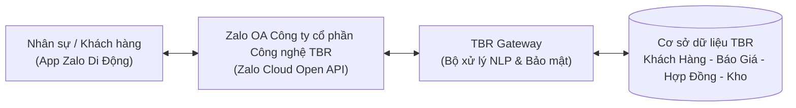
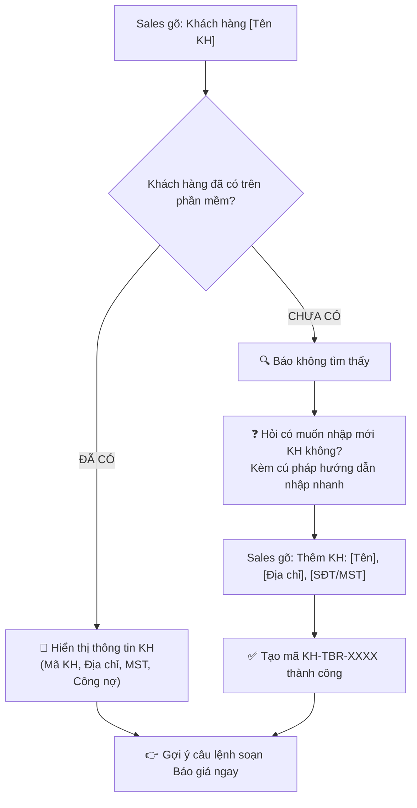
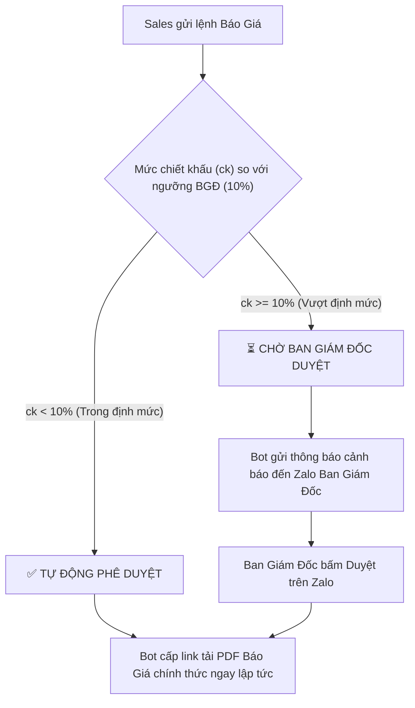
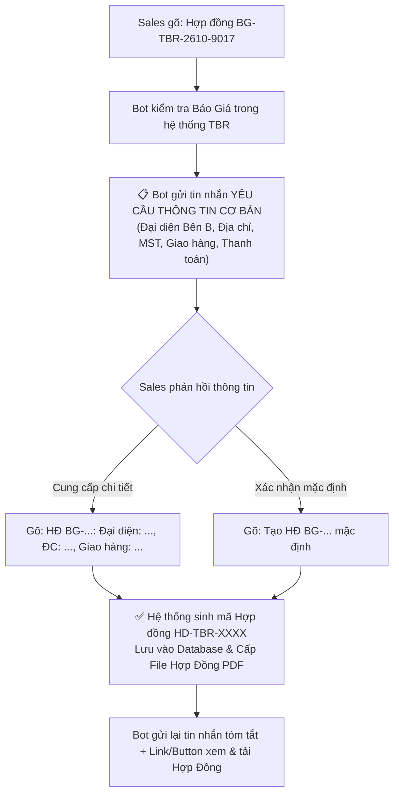

# CẨM NANG HƯỚNG DẪN SỬ DỤNG HỆ THỐNG ZALO ĐIỀU HÀNH
## (CÔNG TY CỔ PHẦN CÔNG NGHỆ TBR - ZALO OA BOT)

> **Đơn vị phát hành**: CÔNG TY CỔ PHẦN CÔNG NGHỆ TBR  
> **Đối tượng áp dụng**: Ban Giám Đốc, Đội ngũ Kinh Doanh (Sales), Quản Lý Kho & Quản Trị Viên Hệ Thống.  
> **Phiên bản**: Zalo OpenAPI v3.0 • Zalo Cloud Tier Package (Gói Tăng Trưởng) • Cập nhật tính năng Quản lý Khách hàng, Báo giá & Soạn Hợp Đồng tự động

---

## 📑 MỤC LỤC
1. [Khái quát mô hình hoạt động](#1-khái-quát-mô-hình-hoạt-động)
2. [Bước 1: Kích hoạt liên kết Zalo nhân sự](#2-bước-1-kích-hoạt-liên-kết-zalo-nhân-sự)
3. [Nghiệp vụ 1: Tra cứu Tồn kho & Hạn dùng (FEFO)](#3-nghiệp-vụ-1-tra-cứu-tồn-kho--hạn-dùng-fefo)
4. [Nghiệp vụ 2: Tra cứu & Thêm mới Khách hàng qua Zalo](#4-nghiệp-vụ-2-tra-cứu--thêm-mới-khách-hàng-qua-zalo)
5. [Nghiệp vụ 3: Tự động soạn Báo giá & Cấp file PDF](#5-nghiệp-vụ-3-tự-động-soạn-báo-giá--cấp-file-pdf)
6. [Nghiệp vụ 4: Soạn & Gửi Hợp Đồng Mua Bán từ Mã Báo Giá](#6-nghiệp-vụ-4-soạn--gửi-hợp-đồng-mua-bán-từ-mã-báo-giá)
7. [Nghiệp vụ 5: Ban Giám Đốc phê duyệt chiết khấu qua Zalo](#7-nghiệp-vụ-5-ban-giám-đốc-phê-duyệt-chiết-khấu-qua-zalo)
8. [Nghiệp vụ 6: Giữ chỗ hàng hóa khẩn cấp (48 Giờ)](#8-nghiệp-vụ-6-giữ-chỗ-hàng-hóa-khẩn-cấp-48-giờ)
9. [Nghiệp vụ 7: Báo cáo ngày (Daily Log) & Tài liệu CO/CQ](#9-nghiệp-vụ-7-báo-cáo-ngày-daily-log--tài-liệu-cocq)
10. [Bảng tổng hợp nhanh các câu lệnh](#10-bảng-tổng-hợp-nhanh-các-câu-lệnh)
11. [Hướng dẫn dành cho Quản trị viên trên TBR Portal](#11-hướng-dẫn-dành-cho-quản-trị-viên-trên-tbr-portal)

---

## 1. KHÁI QUÁT MÔ HÌNH HOẠT ĐỘNG

Hệ thống Zalo Điều Hành kết nối trực tiếp tài khoản **Zalo Official Account (OA)** của Công ty cổ phần Công nghệ TBR với cơ sở dữ liệu **TBR Portal**. Nhân sự và Ban Giám Đốc chỉ cần thao tác bằng tin nhắn Zalo trên điện thoại di động:



* **Sales (Kinh doanh)**:
  * Tra cứu nhanh xem Bệnh viện / Phòng khám đã có trên hệ thống hay chưa.
  * Nếu chưa có: Nhập thông tin khách hàng mới trực tiếp qua Zalo chỉ bằng 1 tin nhắn.
  * Soạn báo giá tự động, nhận link tải file PDF chính thức của công ty.
  * **Soạn Hợp Đồng Mua Bán từ Mã Báo Giá**: Nhận tin nhắn hướng dẫn thông tin cơ bản, xác nhận hoặc bổ sung đại diện/điều khoản, nhận lại ngay **File Hợp Đồng Mua Bán chính thức (PDF/In ấn)**.
  * Tra cứu tồn kho thực tế, số lô, hạn dùng theo chuẩn FEFO.
* **Kho**: Quản lý xuất kho theo FEFO (hạn ngắn xuất trước), tự động bảo vệ số lượng hàng đang giữ chỗ.
* **Ban Giám Đốc**: Nhận cảnh báo duyệt chiết khấu tức thì qua Zalo, phê duyệt 1 chạm không cần mở máy tính.

---

## 2. BƯỚC 1: KÍCH HOẠT LIÊN KẾT ZALO NHÂN SỰ

> [!NOTE]
> Zalo bảo mật số điện thoại của người dùng, vì vậy hệ thống nhận diện nhân sự qua **Zalo User ID**. Mỗi nhân viên chỉ cần kích hoạt **01 lần duy nhất**.

### Cách 1: Nhân viên tự kích hoạt (Nhanh nhất)
1. Mở ứng dụng Zalo cá nhân, tìm và bấm **Quan tâm** trang Zalo OA Công ty cổ phần Công nghệ TBR.
2. Nhắn tin chứa **Số điện thoại** (ví dụ: `0987875934`) hoặc **Mã nhân viên** (ví dụ: `NV-TBR-018`).
3. Hệ thống tự động xác thực và kích hoạt quyền điều hành ngay lập tức.

### Cách 2: Quản trị viên gán trên TBR Portal
1. Truy cập TBR Portal ➔ Vào mục **Zalo Điều Hành** ➔ Chọn tab **Lịch sử Tin nhắn**.
2. Tìm dòng tin nhắn của nhân sự (nhãn vàng `CHƯA LIÊN KẾT`).
3. Bấm **`+ Gán Zalo ID`** ➔ Chọn nhân sự trong danh bạ ➔ Bấm **Lưu**.

---

## 3. NGHIỆP VỤ 1: TRA CỨU TỒN KHO & HẠN DÙNG (FEFO)

Áp dụng chuẩn **FEFO (First Expired, First Out)** — tự động ưu tiên hiển thị các lô hàng có hạn dùng gần nhất trong kho TBR.

### Các mẫu câu lệnh hợp lệ:
* `Tồn kho [Mã SKU]` *(Ví dụ: `Tồn kho HI-612`)*
* `Check kho [Mã SKU]` *(Ví dụ: `Check kho SQH-115`)*
* `Tra cứu tồn kho mã [Mã SKU]` *(Ví dụ: `Tra cứu tồn kho mã HI-612`)*
* `Kiểm tra kho [Từ khóa/Tên]` *(Ví dụ: `Kiểm tra kho HPV`)*
* `Tồn kho` *(Xem danh sách 10 lô hàng sắp hết hạn nhất trong kho)*

### Mẫu bot phản hồi:
```text
📦 KẾT QUẢ TRA CỨU TỒN KHO & HẠN DÙNG THỰC TẾ (FEFO):

1. [HI-612] TopSENSI ® HBV Real-time PCR Kit
   • Tồn khả dụng: 130 Hộp (Đang giữ chỗ: 20)
   • Số Lô: L260901 • HSD: 15/09/2027 (FEFO)
   • Vị trí lưu kho: Kệ A1-02 (Kho TBR Trung Tâm)
```

---

## 4. NGHIỆP VỤ 2: TRA CỨU & THÊM MỚI KHÁCH HÀNG QUA ZALO

Tính năng này giúp nhân viên kinh doanh tra cứu xem cơ sở y tế / khách hàng đã tồn tại trên phần mềm TBR hay chưa. Nếu chưa có, bot sẽ hỏi và hướng dẫn tạo mới ngay, sau đó có thể soạn báo giá trực tiếp cho khách hàng đó.



### A. Tra cứu khách hàng
* **Cú pháp**: `Khách hàng [Tên / Mã / SĐT / MST]`, `Check KH [Tên]`, `Tra cứu KH [Tên]`, `KH [Tên]`
* **Ví dụ**: `Khách hàng Bệnh Viện Chợ Rẫy` hoặc `Check KH 0314892019`

### B. Trường hợp 1: Khách hàng ĐÃ CÓ trên phần mềm
Bot phản hồi chi tiết thông tin và hướng dẫn soạn báo giá:
```text
🏢 THÔNG TIN KHÁCH HÀNG TÌM THẤY TRÊN HỆ THỐNG:

1. [KH-BVCR] Bệnh Viện Chợ Rẫy
   • Phân loại: Bệnh viện / Cơ sở Y tế
   • Địa chỉ: 201B Nguyễn Chí Thanh, P.12, Q.5, TP.HCM
   • MST / ĐT: 0301441837 | 028 3855 4137
   • Người liên hệ: PGS.TS Bác sĩ Nguyễn Trường Sơn (Trưởng khoa)
   • NVKD phụ trách: Bùi Lê Phương Quân
   • Hạn mức công nợ: 500.000.000 VNĐ (Thời hạn TT: 30 ngày)

👉 BẠN CÓ THỂ LẬP BÁO GIÁ CHO KHÁCH HÀNG NÀY NGAY BÂY GIỜ:
Soạn tin: "Báo giá Bệnh Viện Chợ Rẫy: 2 bộ HI-612, ck 0%"
```

### C. Trường hợp 2: Khách hàng CHƯA CÓ trên phần mềm
Bot thông báo không tìm thấy, hỏi xác nhận và hướng dẫn cú pháp nhập nhanh:
```text
🔍 KẾT QUẢ TRA CỨU:
Không tìm thấy thông tin khách hàng nào khớp với từ khóa "bv hùng vương" trên phần mềm!

❓ BẠN CÓ MUỐN NHẬP / TẠO MỚI KHÁCH HÀNG NÀY VÀO HỆ THỐNG KHÔNG?

📋 HƯỚNG DẪN NHẬP KHÁCH HÀNG MỚI QUA ZALO:
Soạn tin nhắn theo cú pháp:
"Thêm KH: [Tên khách hàng], [Địa chỉ], [SĐT hoặc MST], [Người liên hệ]"

💡 Ví dụ:
Thêm KH: Bệnh Viện Hùng Vương, 128 Hồng Bàng Phường 12 Quận 5 TP.HCM, 02838558510, Bác sĩ Trưởng Khoa Xét Nghiệm

👉 SAU KHI THÊM, BẠN CÓ THỂ YÊU CẦU BÁO GIÁ NGAY:
Soạn: "Báo giá Bệnh Viện Hùng Vương: 2 bộ HI-612, ck 0%"
```

### D. Cú pháp nhập / tạo mới khách hàng qua Zalo
* **Cú pháp**: `Thêm KH: [Tên khách hàng], [Địa chỉ], [SĐT hoặc MST], [Người liên hệ]`
* **Ví dụ**: `Thêm KH: Bệnh Viện Hùng Vương, 128 Hồng Bàng Q5 TP.HCM, 02838558510, Bác sĩ Trưởng Khoa`
* Hệ thống tự động cấp mã `KH-TBR-XXXX`, lưu vào bảng khách hàng trên TBR Portal và mở quyền báo giá ngay!

---

## 5. NGHIỆP VỤ 3: TỰ ĐỘNG SOẠN BÁO GIÁ & CẤP FILE PDF

Sales chỉ cần gõ nội dung yêu cầu, hệ thống sẽ tự động tính toán đơn giá, thuế VAT 8%, chiết khấu và tạo báo giá chính thức.

### Cú pháp:
`Báo giá [Tên Bệnh Viện / Khách Hàng]: [Số Lượng] [Mã Hàng], ck [X]%`

### Ví dụ:
* `Báo giá Bệnh Viện Chợ Rẫy: 10 kit HBV, 2 máy tách chiết 32 mẫu, ck 5%`
* `Báo giá Bệnh Viện Hùng Vương: 2 bộ HI-612, ck 0%`

### Cơ chế phân luồng phê duyệt:


---

## 6. NGHIỆP VỤ 4: SOẠN & GỬI HỢP ĐỒNG MUA BÁN TỪ MÃ BÁO GIÁ

Khi khách hàng đã đồng ý với bảng báo giá, Sales hoặc Quản lý có thể tạo ngay **Hợp Đồng Mua Bán chính thức** từ mã báo giá đã có:



### Bước 1: Yêu cầu soạn hợp đồng
Sales gửi tin nhắn:
`Hợp đồng [Mã Báo Giá]` *(Ví dụ: `Hợp đồng BG-TBR-2610-9017` hoặc `Soạn hợp đồng từ BG-TBR-2610-9017`)*

---

### Bước 2: Bot gửi tin nhắn yêu cầu thông tin cơ bản
Bot tự động dò thông tin hồ sơ của khách hàng trong cơ sở dữ liệu và yêu cầu xác nhận/bổ sung:

```text
📋 YÊU CẦU THÔNG TIN CƠ BẢN ĐỂ SOẠN THẢO HỢP ĐỒNG:

Hệ thống đã tìm thấy Báo giá [BG-TBR-2610-9017]
🏥 Đơn vị / Bên Mua (Bên B): Bệnh Viện Chợ Rẫy
💰 Tổng giá trị hợp đồng: 11.340.000 VNĐ (Đã bao gồm VAT 8%)

Để hoàn tất bản Hợp Đồng Mua Bán có đầy đủ tính pháp lý và thông tin xác thực, vui lòng cung cấp hoặc xác nhận các thông tin cơ bản sau:

1. Đại diện Bên B: Họ tên & Chức vụ (Ví dụ: PGS.TS Nguyễn Trường Sơn - Giám Đốc)
2. Địa chỉ trụ sở & Địa điểm giao hàng: (Hiện có: 201B Nguyễn Chí Thanh, P.12, Q.5, TP.HCM)
3. Mã số thuế: (Hiện có: 0301441837) | Số điện thoại liên hệ
4. Thời hạn giao hàng (Mặc định: Trong vòng 07 ngày làm việc)
5. Điều kiện thanh toán (Mặc định: Chuyển khoản trong vòng 30 ngày)

✍️ CÚ PHÁP PHẢN HỒI LẠI ĐỂ TẠO FILE HỢP ĐỒNG:
"HĐ BG-TBR-2610-9017: Đại diện: [Họ tên - Chức vụ], ĐC: [Địa chỉ], MST: [MST], Giao hàng: [Số ngày], TT: [Số ngày]"

💡 Ví dụ mẫu:
HĐ BG-TBR-2610-9017: Đại diện: PGS.TS Nguyễn Trường Sơn - Giám Đốc, ĐC: 201B Nguyễn Chí Thanh Q5 TP.HCM, MST: 0301441837, Giao hàng: 7 ngày, TT: 30 ngày

👉 Hoặc nếu đồng ý sử dụng toàn bộ thông tin mặc định theo hồ sơ khách hàng, bạn chỉ cần gửi:
"Tạo HĐ BG-TBR-2610-9017 mặc định"
```

---

### Bước 3: Sales gửi lại thông tin và nhận File Hợp Đồng PDF

#### Cách 1: Gửi kèm thông tin chi tiết
`HĐ BG-TBR-2610-9017: Đại diện: PGS.TS Nguyễn Trường Sơn - Giám Đốc, ĐC: 201B Nguyễn Chí Thanh Q5 TP.HCM, MST: 0301441837, Giao hàng: 5 ngày, TT: 30 ngày`

#### Cách 2: Đồng ý sử dụng thông tin mặc định
`Tạo HĐ BG-TBR-2610-9017 mặc định`

#### Mẫu Bot phản hồi xác nhận & Cấp File Hợp Đồng PDF:
```text
📜 ĐÃ SOẠN THẢO HỢP ĐỒNG MUA BÁN THÀNH CÔNG! [HD-TBR-2610-9104]
✅ Căn cứ theo Báo giá số: BG-TBR-2610-9017

🏢 BÊN BÁN (BÊN A): CÔNG TY CỔ PHẦN CÔNG NGHỆ TBR
🏥 BÊN MUA (BÊN B): Bệnh Viện Chợ Rẫy
👤 Đại diện Bên B: PGS.TS Nguyễn Trường Sơn — Chức vụ: Giám Đốc
📍 Địa chỉ giao hàng: 201B Nguyễn Chí Thanh, P.12, Q.5, TP.HCM
🧾 Mã số thuế: 0301441837 | SĐT: 028 3855 4137
💰 TỔNG GIÁ TRỊ HỢP ĐỒNG: 11.340.000 VNĐ (Đã bao gồm VAT 8%)
🚚 Thời hạn giao hàng: Trong vòng 05 ngày kể từ ngày hợp đồng có hiệu lực.
💳 Điều kiện thanh toán: Chuyển khoản trong vòng 30 ngày kể từ ngày nhận đủ hóa đơn hợp lệ.
👨‍💼 NVKD quản lý: Bùi Lê Phương Quân

📎 ĐƯỜNG LINK XEM & TẢI FILE HỢP ĐỒNG CHÍNH THỨC (PDF/IN ẤN):
https://tbr-portal.vn/api/zalo/contract-pdf?code=HD-TBR-2610-9104
```

> [!TIP]
> File Hợp Đồng được xuất chuẩn mẫu pháp lý Việt Nam (*Quốc hiệu, Tiêu ngữ, Căn cứ Luật Dân sự & Luật Thương mại, Bảng danh mục sản phẩm, Điều khoản bảo hành, giao hàng, thanh toán và chữ ký đại diện xác thực của TBR*). Sales có thể bấm trực tiếp nút **`📜 Mở File Hợp Đồng`** trên Zalo để xem hoặc in ấn / lưu PDF gửi khách hàng!

---

## 7. NGHIỆP VỤ 5: BAN GIÁM ĐỐC PHÊ DUYỆT CHIẾT KHẤU QUA ZALO

Dành riêng cho tài khoản Ban Giám Đốc TBR. Khi Sales xin chiết khấu từ 10% trở lên, Ban Giám Đốc nhận được thông báo chi tiết và có thể duyệt bằng 3 cách:

1. **Nhắn tin trực tiếp**: `Duyệt [Mã Báo Giá]` *(Ví dụ: `Duyệt BG-TBR-2610-1092`)*
2. **Bấm nút tương tác**: Bấm nút **`[✅ Duyệt BG-TBR-XXXX]`** trên Zalo.
3. **Duyệt trên Web Portal**: Vào tab **Phê duyệt chiết khấu BGĐ** và bấm **Duyệt**.

---

## 8. NGHIỆP VỤ 6: GIỮ CHỖ HÀNG HÓA KHẨN CẤP (48 GIỜ)

Dùng khi cần khóa tạm thời số lượng tồn kho để phục vụ khách hàng trình thầu hoặc chuẩn bị hợp đồng.

### Cú pháp:
`Giữ chỗ [Số Lượng] [Mã SKU] cho [Tên Khách Hàng]`

### Ví dụ:
`Giữ chỗ 10 SQH-115 cho BV Bạch Mai`

---

## 9. NGHIỆP VỤ 7: BÁO CÁO NGÀY (DAILY LOG) & TÀI LIỆU CO/CQ

1. **Nộp báo cáo ngày**:
   * Cú pháp: `Daily: [Nội dung công việc]` hoặc `Nhật ký: [Nội dung]`
   * Ví dụ: `Daily: Hoàn tất bàn giao máy PCR cho BV Chợ Rẫy, khách hẹn nghiệm thu thứ 5.`
2. **Tra cứu tài liệu kỹ thuật & Giấy CO/CQ**:
   * Cú pháp: `Tài liệu [Mã]`, `CO CQ [Mã]`, hoặc `Catalog [Mã]`
   * Ví dụ: `Tài liệu Realtime PCR` hoặc `CO CQ kit HBV`
3. **Xem hướng dẫn tổng quát**:
   * Gõ: `Menu`, `Help` hoặc `Hướng dẫn`.

---

## 10. BẢNG TỔNG HỢP NHANH CÁC CÂU LỆNH

| Nghiệp vụ | Cú pháp ví dụ | Kết quả nhận được từ Bot |
| :--- | :--- | :--- |
| **Tra cứu khách hàng** | `Khách hàng BV Chợ Rẫy` hoặc `Check KH 0314892019` | Thông tin khách hàng / Hướng dẫn tạo mới nếu chưa có |
| **Thêm mới khách hàng** | `Thêm KH: BV Hùng Vương, 128 Hồng Bàng Q5, 02838558510` | Cấp mã `KH-TBR-XXXX`, lưu DB Portal và mở quyền báo giá ngay |
| **Soạn báo giá tự động** | `Báo giá BV Chợ Rẫy: 10 HI-612, ck 5%` | Bảng tính chiết khấu + VAT + Link PDF tải về chính thức |
| **Soạn Hợp Đồng từ Báo Giá** | `Hợp đồng BG-TBR-2610-9017` | Yêu cầu thông tin cơ bản & cấp file Hợp Đồng PDF chính thức |
| **Tạo Hợp Đồng mặc định** | `Tạo HĐ BG-TBR-2610-9017 mặc định` | Xuất file Hợp Đồng ngay theo hồ sơ khách hàng có sẵn |
| **BGĐ Duyệt chiết khấu** | `Duyệt BG-TBR-2610-1092` | Xác nhận duyệt & mở khóa link PDF Báo Giá chính thức |
| **Tra cứu tồn kho FEFO** | `Tồn kho HI-612` hoặc `Check kho SQH-115` | Tồn khả dụng, số lô, hạn dùng FEFO, vị trí lưu kho |
| **Giữ chỗ kho 48h** | `Giữ chỗ 10 SQH-115 cho BV Bạch Mai` | Cấp mã `RES-XXXX`, khóa tồn kho 48h tránh xuất trùng |
| **Nộp báo cáo Daily** | `Daily: Demo máy thành công tại Chợ Rẫy` | Đồng bộ vào mục Nhật ký điều hành TBR Portal |
| **Tài liệu & CO/CQ** | `Tài liệu PCR` hoặc `CO CQ kit HBV` | Link tải IFU Tiếng Việt, Giấy phép Bộ Y Tế, CO/CQ |
| **Trợ giúp & Menu lệnh** | `Menu` hoặc `Help` | Cẩm nang danh mục câu lệnh nhanh |

---

## 11. HƯỚNG DẪN DÀNH CHO QUẢN TRỊ VIÊN TRÊN TBR PORTAL

Quản trị viên truy cập mục **Zalo Điều Hành (Zalo Hub)**:

* **Xem & Tải File Báo Giá / Hợp Đồng trực tiếp**:
  * Tại cột *Nội dung tin nhắn*, bấm nút màu xanh **`📄 Mở File Báo Giá PDF`** hoặc **`📜 Mở File Hợp Đồng PDF`** để mở ngay file trong tab mới.
  * Bấm **`👁️ Xem chi tiết`** để xem toàn văn tin nhắn, sao chép nội dung hoặc mở liên kết.
* **Gói cước Zalo Cloud**:
  * OA bắt buộc dùng **Gói Tăng Trưởng (hoặc Cao cấp)** để Zalo mở cổng API gửi tin nhắn tự động hai chiều (`oa/message/cs`).
* **Làm mới Access Token (Hạn 25 giờ)**:
  * Khi token Zalo hết hạn hoặc bảng nhật ký báo `FAILED TOKEN HẾT HẠN`, Quản trị viên chỉ cần vào tab **Cấu hình Zalo Hub** và bấm nút **`🔄 Làm mới Access Token`**.
