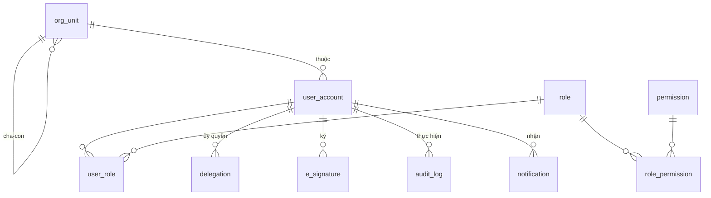
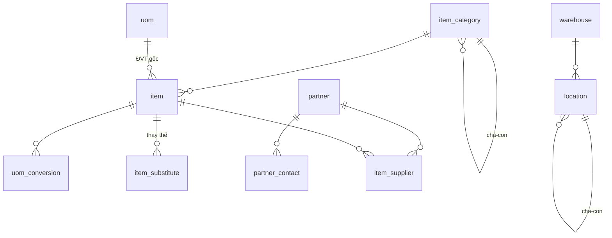
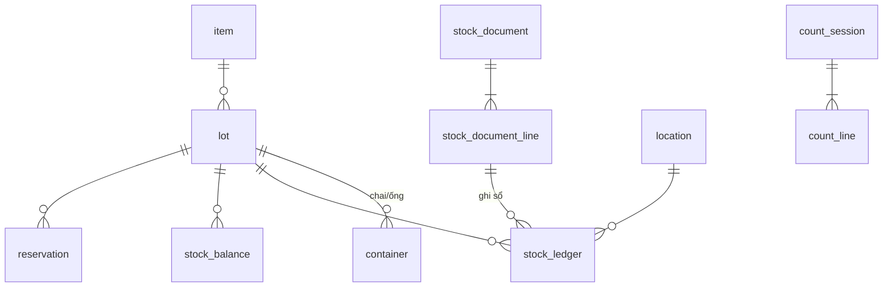
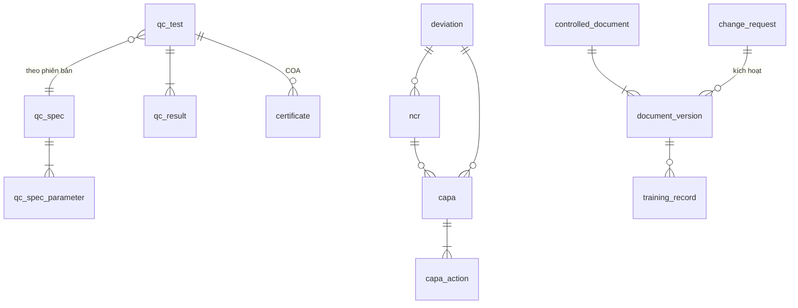
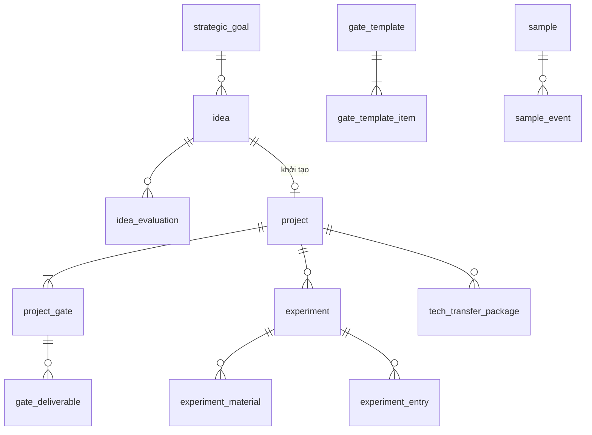
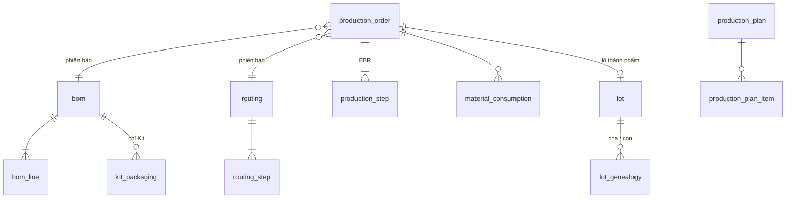
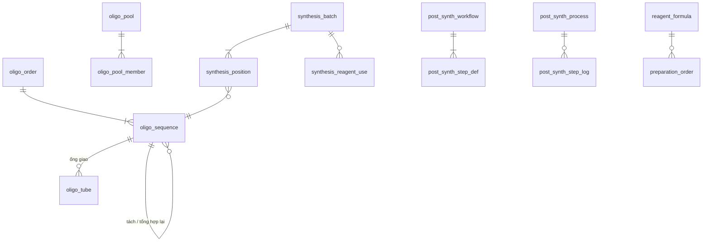
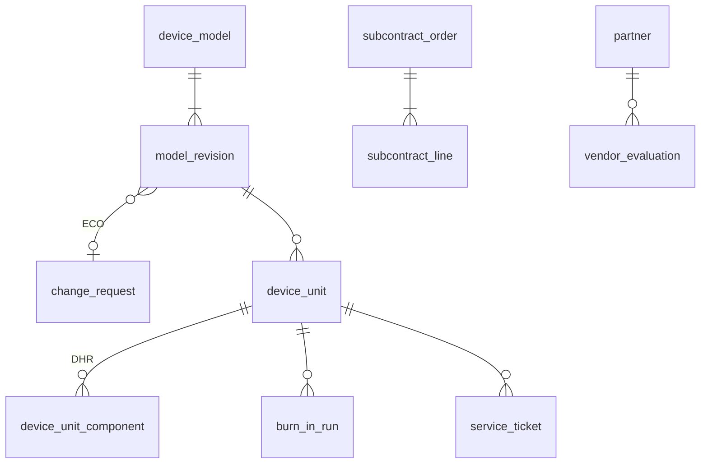

# Đặc tả mô hình dữ liệu (ERD) — Nền tảng R&D / Sản xuất Kit / Oligo / Thiết bị

> Tài liệu đính kèm cho **Bước 1** của prompt xây dựng hệ thống. AI phải dùng mô hình này làm
> khung, được phép đề xuất bổ sung/điều chỉnh nhưng phải liệt kê rõ thay đổi và lý do.
> Máy trạng thái của từng thực thể nằm ở [02-may-trang-thai.md](02-may-trang-thai.md).

## 0. Quy ước chung

### 0.1 Tổ chức CSDL
Một PostgreSQL duy nhất, mỗi miền nghiệp vụ một schema:

| Schema | Nội dung | Phòng sở hữu |
|---|---|---|
| `core` | Người dùng, tổ chức, phân quyền, audit, chữ ký, file, thông báo, bộ đếm mã | IT / BGĐ |
| `master` | Danh mục vật tư, đơn vị tính, đối tác, kho & vị trí | Kho / Mua hàng |
| `asset` | Thiết bị phòng lab, hiệu chuẩn, bảo trì, đặt lịch | Dùng chung |
| `inv` | Lô, chai/ống, chứng từ kho, sổ cái, tồn, giữ chỗ | Kho |
| `purchase` | Đề nghị mua, đơn mua, nhận hàng | Mua hàng |
| `sales` | Bảng giá, báo giá, đơn bán, giao hàng, hóa đơn | Kinh doanh |
| `qms` | Sai lệch, NCR, CAPA, thay đổi, tài liệu, đào tạo, QC, COA | QA/QC |
| `work` | Kế hoạch tuần, công việc, KPI | Dùng chung |
| `rd` | Ý tưởng, dự án Stage-Gate, thí nghiệm ELN, mẫu sinh học, chuyển giao | R&D |
| `mfg` | BOM, routing, lệnh sản xuất, EBR, phả hệ lô — **dùng chung cho Kit và Thiết bị** | SX Kit, KT-CN |
| `oligo` | Trình tự, modification, mẻ tổng hợp, hậu tổng hợp, pha chế | Oligo |
| `device` | Model/revision, serial (DHR), lão hóa, gia công ngoài, dịch vụ | KT-CN |

Module chỉ đọc/ghi schema của mình; truy cập schema khác qua service của module đó
(hoặc view chỉ đọc được công bố). Khóa ngoại liên schema được phép tới `core`, `master`, `inv`.

### 0.2 Cột chuẩn của mọi bảng nghiệp vụ

| Cột | Kiểu | Ghi chú |
|---|---|---|
| `id` | uuid (v7) | Khóa chính, không lộ ra người dùng làm "mã" |
| `code` | text | Mã nghiệp vụ người đọc được, sinh từ `core.number_sequence`, `UNIQUE` |
| `status` | text | Chỉ đổi qua máy trạng thái, có `CHECK` trong tập giá trị hợp lệ |
| `version` | int | Khóa lạc quan; mỗi UPDATE `WHERE version = :v` rồi +1 |
| `created_at`, `created_by` | timestamptz, uuid | UTC |
| `updated_at`, `updated_by` | timestamptz, uuid | |
| `voided_at`, `voided_by`, `void_reason` | | Thay cho xóa cứng khi đã phát sinh nghiệp vụ |

- Số lượng: `numeric(18,6)`; tiền: `numeric(18,2)` + `currency` (mặc định VND).
- Liên kết đa hình (một bản ghi gắn được vào nhiều loại thực thể — file, chữ ký, QC, NCR…)
  dùng cặp `entity_type` (text, theo danh mục cố định) + `entity_id` (uuid), có index chung.
- Dữ liệu thông số mềm (tham số bước, kết quả thí nghiệm) dùng `jsonb` **có JSON Schema**
  lưu kèm định nghĩa bước/mẫu; không dùng jsonb cho dữ liệu cần lọc/tổng hợp thường xuyên.

---

## 1. `core` — Nền tảng

| Bảng | Cột chính | Ràng buộc / ghi chú |
|---|---|---|
| `org_unit` | code, name, type (COMPANY/DEPARTMENT/TEAM), parent_id, module_key (RD/KIT/OLIGO/DEVICE/QA/WH/SALES/PURCHASE/HR/BOD) | Cây tổ chức; `module_key` dùng để định tuyến công việc |
| `user_account` | username, email, full_name, org_unit_id, password_hash (argon2), pin_hash, status (ACTIVE/LOCKED/DISABLED), failed_attempts, locked_until, last_login_at | `UNIQUE(lower(username))`, `UNIQUE(lower(email))` |
| `role` | code, name, description | Ví dụ: `OLIGO_OPERATOR`, `QC_ANALYST`, `QA_RELEASER`, `DEPT_HEAD`, `BOD` |
| `permission` | code (`oligo.batch.create`), module, action, is_gxp_critical | Danh mục cố định, khai báo trong code, đồng bộ khi deploy |
| `role_permission` | role_id, permission_id | |
| `user_role` | user_id, role_id, scope_org_unit_id (null = toàn công ty), valid_from, valid_to | Quyền = vai trò × phạm vi phòng ban |
| `delegation` | from_user_id, to_user_id, role_id, valid_from, valid_to, reason | Ủy quyền có thời hạn, ghi audit |
| `refresh_token` | user_id, token_hash, expires_at, revoked_at, user_agent, ip | Thu hồi được |
| `number_sequence` | key (`SO`, `LOT_KIT`, `SN_DEVICE`…), pattern (`B{YY}{MM}{NNN}`), reset_policy (NEVER/YEARLY/MONTHLY/DAILY), current_period, last_value | Cấp số bằng `UPDATE … RETURNING` trong transaction; không bao giờ tái sử dụng số |
| `audit_log` | occurred_at, user_id, on_behalf_of, entity_type, entity_id, action, changes jsonb (`{field: [old, new]}`), reason, request_id, ip | **Chỉ INSERT** (thu quyền UPDATE/DELETE ở mức DB role); partition theo tháng |
| `e_signature` | entity_type, entity_id, entity_version, meaning (PERFORMED/CHECKED/REVIEWED/APPROVED/RELEASED), signer_id, signed_at, reason, auth_method (PIN/PASSWORD), record_hash (SHA-256 nội dung lúc ký) | Chỉ INSERT; sửa bản ghi sau khi ký làm chữ ký "hết hiệu lực" (so hash) |
| `attachment` | entity_type, entity_id, category, file_name, mime_type, size_bytes, sha256, storage_key, uploaded_by | File trên MinIO; giới hạn dung lượng theo category |
| `notification` | user_id, type, title, body, entity_type, entity_id, link, created_at, read_at | |
| `notification_rule` | event_type, target (ROLE/ORG_UNIT/USER), target_id, channel (APP/EMAIL) | Cấu hình ai nhận sự kiện gì |
| `idempotency_key` | key, user_id, endpoint, request_hash, response_json, created_at | TTL 24h |
| `outbox_event` | event_type, payload jsonb, created_at, processed_at, attempts | Domain event giữa module, xử lý bởi worker |

---

## 2. `master` — Danh mục chủ

| Bảng | Cột chính | Ghi chú |
|---|---|---|
| `uom` | code, name, dimension (MASS/VOLUME/COUNT/AMOUNT/OD) | Ví dụ: `mL`, `µL`, `g`, `nmol`, `OD`, `test`, `kit`, `pcs` |
| `uom_conversion` | from_uom, to_uom, factor, item_id (null = quy đổi chung) | `kit → test` phụ thuộc từng item |
| `item_category` | code, name, parent_id | |
| `item` | code, name, item_type, category_id, base_uom, tracking (NONE/LOT/SERIAL), shelf_life_days, open_shelf_life_days, storage_condition (RT/2-8/-20/-80), min_stock, reorder_qty, receipt_qc_required, is_purchasable, is_saleable, is_manufacturable, hazard_class, sds_attachment_id, status (ACTIVE/INACTIVE) | `item_type`: RAW_MATERIAL, REAGENT, CONSUMABLE, COMPONENT, SEMI_FINISHED, FINISHED_KIT, DEVICE, OLIGO_SERVICE, SPARE_PART |
| `item_substitute` | item_id, substitute_item_id, ratio, priority, allowed_modules[] | Thay thế khi phân bổ lô; phải được QA duyệt (qua change_request) |
| `partner` | code, name, tax_code, is_customer, is_supplier, is_subcontractor, address, payment_terms, customer_tier (END/DEALER), status | `UNIQUE(tax_code)` khi không null |
| `partner_contact` | partner_id, name, phone, email, role | |
| `item_supplier` | item_id, partner_id, supplier_item_code, lead_time_days, moq, last_price | |
| `warehouse` | code, name, owner_org_unit_id, purpose (RAW/FINISHED/QUARANTINE/RD/OLIGO/DEVICE_PARTS) | |
| `location` | warehouse_id, parent_id, code, name, temperature_condition, is_quarantine | Kho → tủ → kệ → ngăn |

---

## 3. `asset` — Thiết bị phòng lab

| Bảng | Cột chính | Ghi chú |
|---|---|---|
| `asset` | code, name, asset_type (SYNTHESIZER/HPLC/PCR/CENTRIFUGE/FREEZER/BALANCE/…), manufacturer, model, serial_no, location_id, owner_org_unit_id, status, calibration_interval_days, next_calibration_due, maintenance_interval_days, next_maintenance_due, requires_booking | Thiết bị quá hạn hiệu chuẩn → không chọn được trong mẻ/thí nghiệm |
| `asset_event` | asset_id, event_type (CALIBRATION/MAINTENANCE/REPAIR/QUALIFICATION_IQ_OQ_PQ), planned_date, done_at, performed_by, vendor_id, result (PASS/FAIL), certificate_attachment_id, notes | Hoàn thành CALIBRATION PASS cập nhật `next_calibration_due` |
| `asset_booking` | asset_id, user_id, period tstzrange, purpose, entity_type, entity_id, status | `EXCLUDE USING gist (asset_id WITH =, period WITH &&) WHERE status='CONFIRMED'` — chống trùng lịch ở mức DB |
| `asset_usage_log` | asset_id, entity_type, entity_id, started_at, ended_at, user_id, run_params jsonb | Ghi tự động khi thiết bị được dùng trong mẻ/bước |

---

## 4. `inv` — Kho, lô, sổ cái

| Bảng | Cột chính | Ràng buộc / ghi chú |
|---|---|---|
| `lot` | code (nội bộ), item_id, mfr_lot_no, supplier_id, mfg_date, expiry_date, received_date, quality_status, origin (PURCHASE/PRODUCTION/PREPARATION/SYNTHESIS/RETURN/OPENING), origin_entity_type, origin_entity_id, coa_attachment_id | `UNIQUE(item_id, code)`; máy trạng thái chất lượng ở tài liệu 02 |
| `container` | code (barcode), lot_id, initial_qty, uom, opened_at, open_expiry_date, status | Dùng cho hóa chất theo chai (Oligo, R&D). Hạn hiệu lực = min(expiry lot, open_expiry) |
| `stock_document` | code, doc_type (RECEIPT/ISSUE/TRANSFER/ADJUSTMENT/COUNT_ADJUST/RETURN), reason_code, warehouse_id, source_entity_type, source_entity_id, status (DRAFT/POSTED/CANCELLED), posted_at, posted_by | Chứng từ chỉ ghi sổ khi POSTED; hủy = tạo chứng từ đảo, không sửa |
| `stock_document_line` | document_id, item_id, lot_id, container_id, from_location_id, to_location_id, qty, uom, qty_base, unit_cost | `CHECK (qty > 0)` |
| `stock_ledger` | posted_at, item_id, lot_id, container_id, location_id, qty_delta_base, document_line_id | **Chỉ INSERT**. Nguồn sự thật của tồn kho |
| `stock_balance` | item_id, lot_id, container_id, location_id, qty_on_hand, qty_reserved | Cập nhật trong cùng transaction với ledger, khóa dòng `FOR UPDATE`; `CHECK (qty_on_hand >= 0 AND qty_reserved >= 0 AND qty_reserved <= qty_on_hand)`. Job đêm đối chiếu với tổng ledger |
| `reservation` | item_id, lot_id, location_id, qty_base, demand_entity_type (PRODUCTION_ORDER/SYNTHESIS_BATCH/EXPERIMENT/DEVICE_WO/DELIVERY), demand_entity_id, status (ACTIVE/CONSUMED/RELEASED) | Giữ chỗ tách biệt xuất thực tế |
| `count_session` / `count_line` | warehouse, status; lot, system_qty, counted_qty, diff, reason | Duyệt chênh lệch → sinh COUNT_ADJUST |

**Quy tắc phân bổ lô (service, không phải UI):** lọc lô `quality_status = RELEASED`, còn hạn
hiệu lực, thuộc kho được phép của module, `qty_on_hand - qty_reserved > 0`; sắp xếp
`expiry_date ASC NULLS LAST, received_date ASC` (FEFO → FIFO); thiếu mới dùng `item_substitute`
theo `priority`.

---

## 5. `purchase` — Mua hàng

| Bảng | Cột chính | Ghi chú |
|---|---|---|
| `purchase_request` (+`_line`) | code, requester_id, org_unit_id, needed_by, reason, source (MANUAL/MRP/MIN_STOCK), status; line: item_id, qty, uom, est_price | |
| `purchase_order` (+`_line`) | code, supplier_id, order_date, expected_date, currency, status, payment_terms; line: pr_line_id, item_id, qty_ordered, qty_received, unit_price, vat_rate | `qty_received` cộng từ phiếu nhận |
| `goods_receipt` (+`_line`) | code, po_id, received_at, received_by, status; line: po_line_id, item_id, mfr_lot_no, expiry_date, qty, lot_id (sinh khi nhận), iqc_test_id | Nhận → tạo lot QUARANTINE + stock_document RECEIPT vào vị trí biệt trữ; IQC đạt → RELEASED |
| `mrp_run` / `mrp_suggestion` | run_at, horizon; item_id, required_qty, available_qty, on_order_qty, suggested_qty, need_date | Tính từ kế hoạch sản xuất × BOM |

---

## 6. `sales` — Kinh doanh

| Bảng | Cột chính | Ghi chú |
|---|---|---|
| `price_list` | code, name, customer_tier, currency, valid_from, valid_to, status (DRAFT/ACTIVE/ARCHIVED) | Một bảng ACTIVE cho mỗi tier tại một thời điểm |
| `price_list_item` | price_list_id, price_code, item_id, rule_type (FLAT/PER_BASE/PER_MOD/SURCHARGE), conditions jsonb (scale, purification…), unit_price | Oligo tra giá qua `price_code` + điều kiện |
| `quotation` (+`_line`) | code, customer_id, valid_until, pricing_mode (LIST/DEALER_PCT/CUSTOM/DEMO), discount_pct, status; line: item_id/description, qty, unit_price, price_lines_snapshot jsonb | Snapshot giá lúc báo, không tính lại khi bảng giá đổi |
| `sales_order` | code, customer_id, quotation_id, order_date, requested_date, pricing_mode, status, sales_rep_id, notes | Số SO không bao giờ tái sử dụng (kể cả SO đã hủy) |
| `sales_order_line` | so_id, line_no, item_id, qty, uom, unit_price, fulfilment (STOCK/KIT/OLIGO/DEVICE), qty_committed, qty_delivered, requested_date, status | Khóa sửa/xóa khi đã có lệnh sản xuất hoặc giao; không giảm qty dưới `qty_committed` |
| `fulfilment_link` | so_line_id, target_entity_type (PRODUCTION_ORDER/OLIGO_ORDER/DEVICE_ORDER), target_entity_id, qty | Truy vết SO ↔ sản xuất |
| `delivery_note` (+`_line`) | code, so_id, customer_id, ship_date, status, receiver, signed_attachment_id; line: so_line_id, item_id, lot_id / serial_id / oligo_sequence_id, qty | POSTED → tạo stock_document ISSUE |
| `invoice_request` | so_id, tax_code, company_name, address, email, vat_rate (0/5/8/10), amount, status, invoice_no, invoice_date, file_attachment_id | Kết nối HĐĐT sau này |

---

## 7. `qms` — Hệ thống chất lượng (dùng chung)

| Bảng | Cột chính | Ghi chú |
|---|---|---|
| `qc_spec` | code, name, applies_to (ITEM/PRODUCT/OLIGO/DEVICE_MODEL/RECEIPT), item_id, version, status (DRAFT/EFFECTIVE/OBSOLETE) | Thay đổi spec qua change_request |
| `qc_spec_parameter` | spec_id, seq, name, method, unit, value_type (NUMERIC/TEXT/PASS_FAIL), lower_limit, upper_limit, target, is_critical | |
| `qc_test` | code, entity_type (LOT/PRODUCTION_ORDER/PRODUCTION_STEP/OLIGO_SEQUENCE/DEVICE_UNIT/RECEIPT_LINE/CONTAINER), entity_id, spec_id, test_kind (IQC/IPQC/FQC/RELEASE/STABILITY), status, analyst_id, reviewer_id, overall_result | Người phân tích ≠ người duyệt |
| `qc_result` | test_id, parameter_id, value_numeric, value_text, passed, instrument_asset_id, raw_attachment_id, entered_by, entered_at | `passed` tính ở server từ giới hạn spec |
| `coa_template` | code, applies_to, version, layout jsonb, status | |
| `certificate` | code, qc_test_id, template_id, template_version, rendered_attachment_id, issued_at, signed_signature_id | COA là bản ghi bất biến sau khi ký |
| `retain_sample` | lot_id, qty, location_id, retain_until, status | |
| `stability_study` / `stability_timepoint` | lot_id, condition, protocol; timepoint, due_date, qc_test_id | |
| `deviation` | code, source_module, entity_type, entity_id, step_ref, severity (LOW/MEDIUM/HIGH/CRITICAL), description, detected_by, performer_id, status | Mọi phòng báo sự cố về đây |
| `ncr` | code, deviation_id, entity_type, entity_id, item_id, lot_id, qty_affected, disposition (PENDING/SCRAP/REWORK/RESYNTHESIZE/USE_AS_IS/RETURN_TO_SUPPLIER), disposition_approved_by, status | USE_AS_IS (đặc cách) cần QA + Trưởng phòng ký |
| `capa` / `capa_action` | code, source refs, root_cause, method (5WHY/FISHBONE), effectiveness_check_date, status; action: owner, due_date, done_at, evidence_attachment_id | |
| `change_request` | code, change_type (DOCUMENT/BOM/ROUTING/SPEC/DESIGN_ECO/SUBSTITUTE/PRICE), title, reason, impact_assessment jsonb, effectivity (DATE/FROM_LOT/FROM_SERIAL), effectivity_value, status | ECO của thiết bị là change_request loại DESIGN_ECO |
| `change_request_item` | change_request_id, target_entity_type, target_entity_id, from_version, to_version | Liên kết phiên bản cũ → mới |
| `controlled_document` | code, title, doc_type (SOP/WI/FORM/SPEC/POLICY), owner_org_unit_id | |
| `document_version` | document_id, version_label, status, effective_date, review_due_date, file_attachment_id, change_request_id | Một phiên bản EFFECTIVE tại một thời điểm |
| `training_record` | user_id, document_version_id, trained_at, trainer_id, method (READ/CLASS/OJT), assessment_passed, status | Bước có `required_training_doc` kiểm tra bảng này |

---

## 8. `work` — Kế hoạch công việc & KPI (dùng chung mọi phòng)

| Bảng | Cột chính | Ghi chú |
|---|---|---|
| `work_plan` | user_id, org_unit_id, week_start (thứ Hai), status, submitted_at, approved_by, approved_at | `UNIQUE(user_id, week_start)` |
| `work_task` | plan_id, title, day_of_week, time_slot, entity_type, entity_id (dự án/thí nghiệm/lệnh SX…), target_metric, is_unplanned, status, result_summary, efficiency_rating, defer_category (OBJECTIVE/SUBJECTIVE), defer_reason, replaced_by_task_id | `is_unplanned = true` khi thêm sau lúc duyệt |
| `task_comment` | task_id, author_id, kind (MANAGER_REVIEW/STAFF_REPLY/REVIEW_REQUEST), body | |
| `kpi_template` / `kpi_template_item` | org_unit_id, period_type; criterion, weight, measure | |
| `kpi_evaluation` / `kpi_evaluation_item` | user_id, period, template_id, total_score, status; item_id, self_score, manager_score, evidence | |

---

## 9. `rd` — Nghiên cứu & Phát triển

| Bảng | Cột chính | Ghi chú |
|---|---|---|
| `strategic_goal` | code, name, period, owner_id, status | |
| `idea` | code, title, description, goal_id, proposer_id, status, vote_count | |
| `evaluation_criterion` | eval_type (TECH/BIZ), code, name, weight, scale_max | Cấu hình trọng số |
| `idea_evaluation` | idea_id, eval_type, evaluator_id, scores jsonb `{criterion_code: điểm}`, weighted_score, analysis, recommendation (APPROVE/REJECT/REVISE), submitted_at | Mỗi idea cần đủ TECH và BIZ |
| `project` | code, name, project_type (NEW_PRODUCT/IMPROVEMENT/PROCESS/RESEARCH), target_domain (KIT/OLIGO/DEVICE/OTHER), idea_id, base_model_revision_id (thiết bị cải tiến), leader_id, gate_template_id, current_stage, status, planned_start, planned_end, actual_transfer_date | Dự án thiết bị dùng gate template DHF |
| `project_member` | project_id, user_id, role_in_project, allocation_pct | |
| `gate_template` / `gate_template_item` | code, name, domain; gate_no, gate_name, stage_after, checklist item (name, required, doc_type) | Ví dụ thiết bị: G1 Khái niệm → G5 Chuyển giao |
| `project_gate` | project_id, gate_no, status, submitted_by, submitted_at, decision (GO/RECYCLE/HOLD/KILL), decided_by, decided_at, decision_note | |
| `gate_deliverable` | project_gate_id, template_item_id, attachment_id, status (MISSING/SUBMITTED/ACCEPTED/REJECTED), reviewer_comment | Gửi duyệt khi mọi item `required` ≥ SUBMITTED |
| `spec_evaluation` | project_id, parameter, baseline_value, target_value, actual_value, result | Bảng thông số mục tiêu/thực tế |
| `experiment` | code, project_id, title, objective, protocol_document_version_id, status, revision, parent_experiment_id, started_at, finished_at, approved_by | Sửa sau duyệt = tạo revision mới |
| `experiment_entry` | experiment_id, seq, entry_type (TEXT/TABLE/IMAGE/FILE/RESULT), content jsonb, attachment_id, created_by, created_at | Nhật ký ELN, chỉ ghi thêm khi đã gửi duyệt |
| `experiment_material` | experiment_id, item_id, lot_id, container_id, qty, uom, stock_document_line_id | Tự sinh phiếu ISSUE kho R&D |
| `experiment_asset` | experiment_id, asset_id, booking_id | |
| `sample` | code, sample_type (BLOOD/SWAB/DNA/RNA/STRAIN/PLASMID/…), source, consent_ref, collected_at, location_id, volume, uom, freeze_thaw_count, status | |
| `sample_event` | sample_id, event_type (RECEIVE/MOVE/ALIQUOT/THAW/USE/DISPOSE), qty, by, at, entity ref | Chuỗi hành trình mẫu |
| `roadmap_milestone` | project_id, title, due_date, status, tags[] | Xuất .ics |
| `tech_transfer_package` | code, project_id, target_domain, bom_draft_id, routing_draft_id, spec_ids[], document_version_ids[], stability_summary, status, accepted_by | Duyệt → tạo bản nháp BOM/routing/model trong module đích |

---

## 10. `mfg` — Sản xuất (dùng chung SX Kit & KT-CN)

| Bảng | Cột chính | Ghi chú |
|---|---|---|
| `bom` | code, product_item_id, domain (KIT/DEVICE), version, status, base_qty, base_uom, shelf_life_days, change_request_id | Một phiên bản EFFECTIVE / sản phẩm |
| `bom_line` | bom_id, line_no, component_item_id, qty_per_base, uom, scrap_pct, parent_line_id (BOM nhiều cấp), station_code (thiết bị), source_type (BUY/MAKE/OUTSOURCE), allow_substitute, is_critical, is_bundled | |
| `kit_packaging` | bom_id, box_no, component_name, fill_qty, fill_uom, container_type, units_per_kit, label_template_id | Cấu trúc hộp → thành phần → ống/chai |
| `operation` | code, name, category (PREPARATION/FORMULATION/FILLING/ASSEMBLY/QC/PACKAGING/BURN_IN) | Danh mục công đoạn |
| `routing` | code, product_item_id, domain, version, status | |
| `routing_step` | routing_id, seq, operation_id, station_code, instructions_document_version_id, param_schema jsonb, is_qc, qc_spec_id, requires_check_signature, required_training_document_id, required_asset_type, std_duration_min | |
| `production_order` | code, domain, product_item_id, bom_id, routing_id, planned_qty, good_qty, uom, lot_id, mfg_date, expiry_date, priority, status, so_line_id, planned_start, planned_end, team_lead_id | `expiry_date` cố định lúc tạo lô = mfg_date + shelf_life (BOM → item → mặc định 365 ngày) |
| `production_step` | order_id, routing_step_id, seq, status, assigned_to, started_at, completed_at, performed_by, checked_by, param_values jsonb, asset_ids[], deviation_id | Bản ghi EBR từng bước |
| `material_consumption` | order_id, bom_line_id, item_id, lot_id, planned_qty, issued_qty, returned_qty, actual_qty, stock_document_line_id | Đối chiếu kế hoạch/thực tế |
| `lot_genealogy` | parent_lot_id, child_lot_id, qty_used, production_order_id | Truy xuất xuôi/ngược |
| `rework_order` | code, ncr_id, production_order_id, scope (FULL/PARTIAL), scope_detail jsonb (ví dụ box_no), status | Cấp bổ sung/làm lại một phần lô |
| `production_plan` / `production_plan_item` | plan_date, org_unit_id, status; production_order_id, step, team, asset_id, planned_hours | |

---

## 11. `oligo` — Tổng hợp Oligo

| Bảng | Cột chính | Ghi chú |
|---|---|---|
| `modification` | code, name, aliases text[], position_type (5PRIME/3PRIME/INTERNAL/BASE_PREFIX), mw_delta, ext_coeff_260, is_fluorophore, is_quencher, amidite_item_id, price_code, status | Bộ phân tích trình tự đọc từ đây (cache có invalidation) |
| `oligo_order` | code, sales_order_id, customer_id, pricing_mode, price_pct, due_date, initial_due_date, due_date_change_count, status | Trạng thái suy ra từ trình tự (xem 02) |
| `oligo_sequence` | code, order_id, name, raw_sequence, normalized_sequence, base_count, molecule_type (DNA/RNA), product_type (PRIMER/PROBE/AMPLICON_LINEAR/AMPLICON_PLASMID/…), scale, purification (DESALT/OPC/HPLC/PAGE), format (LYOPHILIZED/LIQUID), mw, ext_coeff, tm, nmol_per_od, price_snapshot jsonb, price_amount, status, parent_sequence_id, relation (SPLIT/RESYNTH/FRAGMENT), pool_id, plasmid_id | Tính lại thuộc tính khi sửa trình tự (chỉ khi PENDING) |
| `oligo_pool` / `oligo_pool_member` | code, master_sequence_id, scale, status; sequence_id, ratio_pct | Gộp: trình tự trùng khớp; `SUM(ratio_pct) = 100` |
| `oligo_tube` | sequence_id, tube_no, od, nmol, volume_ul_for_100um, label_printed_at, delivery_note_line_id | Chia ống giao khách |
| `synthesizer` | asset_id, column_positions, supported_scales[], reagent_slots jsonb | Mở rộng của `asset.asset` |
| `synthesis_batch` | code, synthesizer_id, status, planned_start, started_at, finished_at, operator_id, program_name | |
| `synthesis_position` | batch_id, position_no, sequence_id, column_lot_id, coupling_efficiency_pct, trityl_ok | `UNIQUE(batch_id, position_no)`; `UNIQUE(sequence_id) WHERE batch active` |
| `synthesis_reagent_use` | batch_id, item_id, lot_id, container_id, est_qty, actual_qty, reservation_id, stock_document_line_id | |
| `post_synth_workflow` / `post_synth_step_def` | code, name, applies_to (purification/product_type), version, status; seq, method_code, param_schema, reagent_rules jsonb, is_qc, allows_batch_log | |
| `post_synth_process` | sequence_id, workflow_id, current_step_seq, status | |
| `post_synth_step_log` | process_id, step_def_id, performed_by, performed_at, params jsonb, asset_id, attachments, reagent_uses jsonb → stock lines | Ghi theo nhóm nhiều trình tự một lần |
| `reagent_formula` | code, name, output_item_id, category, ingredients jsonb `[{item_id, ratio_per_unit}]`, incubation_hours, qc_required, version, status | |
| `preparation_order` | code, formula_id, target_qty, selected_lots jsonb, status, prepared_by, output_lot_id, output_container_ids[] | Chỉ trừ kho khi hoàn thành |

QC oligo dùng `qms.qc_test` với `entity_type = OLIGO_SEQUENCE`: OD260, nồng độ, độ tinh khiết
HPLC/CE, khối phổ (MW lý thuyết vs đo, dung sai theo spec).

---

## 12. `device` — Kỹ thuật-Công nghệ (thiết bị)

| Bảng | Cột chính | Ghi chú |
|---|---|---|
| `device_model` | code, name, item_id, current_revision_id, warranty_months, status (DEVELOPMENT/COMMERCIAL/DISCONTINUED) | Tạo khi dự án R&D thiết bị chuyển giao |
| `model_revision` | model_id, revision (A, B…), bom_id, routing_id, dmr_document_version_ids[], firmware_version, eco_change_request_id, released_at, status | Cải tiến: NEW_REVISION hoặc model mới |
| `device_order` | code, so_line_id, model_revision_id, qty, custom_specs, priority, due_date, lead_engineer_id, status, production_order_id | Đơn thiết bị từ Kinh doanh |
| `device_unit` | serial_no, model_revision_id, production_order_id, status, firmware_version, fqc_test_id, customer_id, delivery_note_line_id, warranty_start, warranty_end | `UNIQUE(serial_no)`; serial sinh từ `number_sequence` |
| `device_unit_component` | unit_id, bom_line_id, item_id, lot_id, component_serial, installed_at, installed_by, station_code | Hồ sơ DHR |
| `burn_in_run` | unit_id, started_at, ended_at, hours, required_hours (mặc định 48), result, log_attachment_id | FQC chỉ mở khi `hours >= required_hours` và PASS |
| `subcontract_part` | code, item_id, vendor_id, material, process_type, tolerance_standard, drawing_attachment_id | |
| `subcontract_order` / `subcontract_line` | code, vendor_id, reference (device_order/project), due_date, status; part_id, qty_ordered, qty_received, qty_accepted, iqc_test_id | Chỉ phần IQC đạt được nhập kho |
| `vendor_evaluation` | vendor_id, eval_type (PERIODIC/POST_ORDER/AUDIT), linked_order_id, quality, delivery, cost, service (1–5), weighted_score, tier, conclusion, evaluator_id | Trọng số 40/25/20/15 cấu hình được; A ≥4.5, B ≥3.5, C ≥2.5, D <2.5 |
| `service_ticket` | code, unit_id, ticket_type (PREVENTIVE/REPAIR/WARRANTY/COMPLAINT/INSTALLATION), reported_at, status, is_warranty, cost, capa_id | Bảo hành xác định từ `warranty_end` |
| `service_schedule` | unit_id, interval_months, next_due | Nhắc bảo trì định kỳ |

---

## 13. Luồng liên kết giữa các phòng (tóm tắt)

| Luồng | Từ → Đến | Cơ chế |
|---|---|---|
| Đơn hàng sản xuất | `sales_order_line` → `production_order` / `oligo_order` / `device_order` | `fulfilment_link` + event `SalesOrderConfirmed` |
| Chuyển giao R&D | `rd.tech_transfer_package` → bản nháp `mfg.bom`/`routing`, `device.device_model`, `qms.qc_spec` | Event `TechTransferAccepted` |
| Thay đổi thiết kế/công thức | `qms.change_request` → phiên bản mới `bom`/`routing`/`spec`/`model_revision` | Kích hoạt khi CR được duyệt và đến ngày hiệu lực |
| Nhu cầu vật tư | `mfg.production_plan` × `bom` → `purchase.mrp_suggestion` → PR | Job MRP |
| Sự cố | Mọi module → `qms.deviation` → `ncr` → `capa` | Service dùng chung |
| Thành phẩm | `production_order` hoàn thành → `lot` RELEASED (QA ký) → `delivery_note` | |
| Truy xuất | `lot_genealogy`, `device_unit_component`, `synthesis_reagent_use`, `delivery_note_line` | API truy xuất 2 chiều |

## 14. Chỉ mục & hiệu năng tối thiểu
- Index mọi khóa ngoại; index `(status)` kết hợp cột lọc chính của danh sách.
- `(entity_type, entity_id)` trên `audit_log`, `attachment`, `e_signature`, `qc_test`, `deviation`.
- `inv.stock_balance(item_id, lot_id, location_id)` UNIQUE; `inv.lot(item_id, expiry_date)`.
- Tìm kiếm trình tự/tên: `pg_trgm` GIN trên `oligo_sequence.normalized_sequence`, `name`, `item.name`.
- Báo cáo nặng (tồn theo ngày, KPI, tiêu hao) dùng materialized view làm mới theo lịch.
