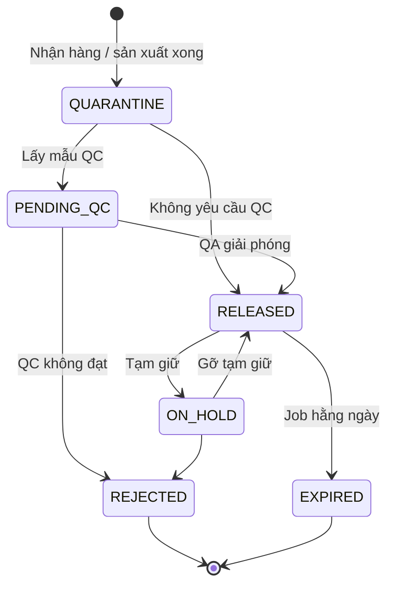
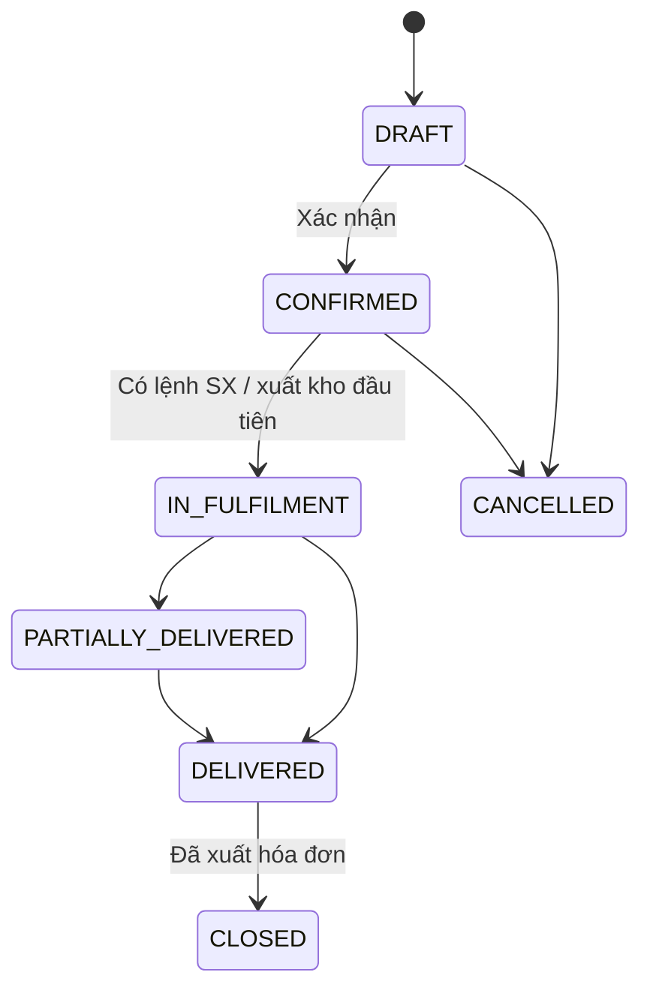
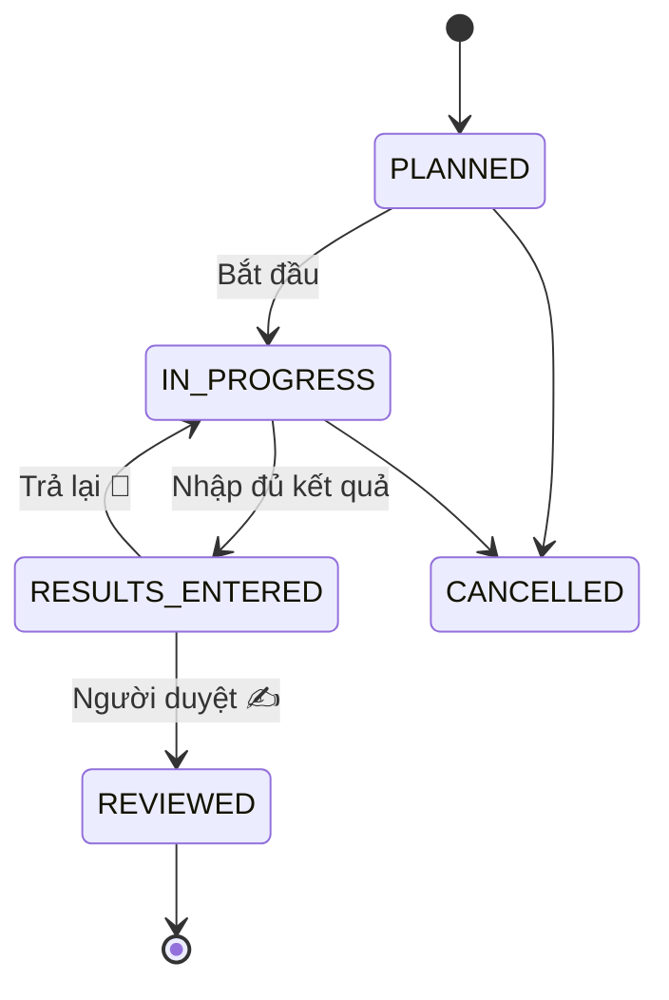
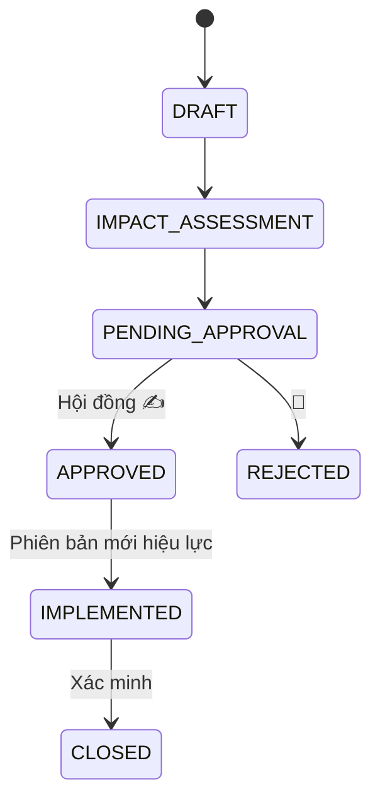
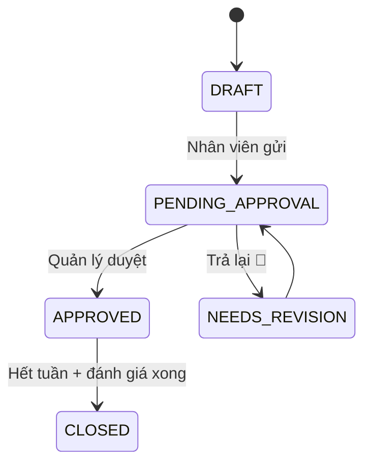
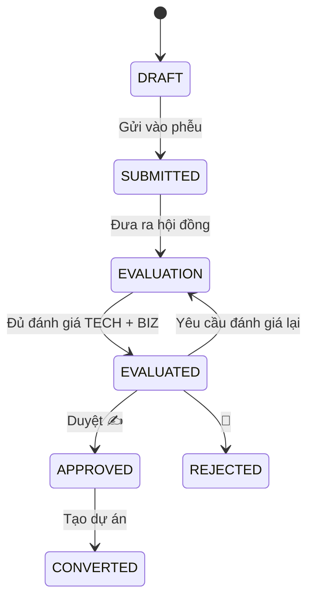
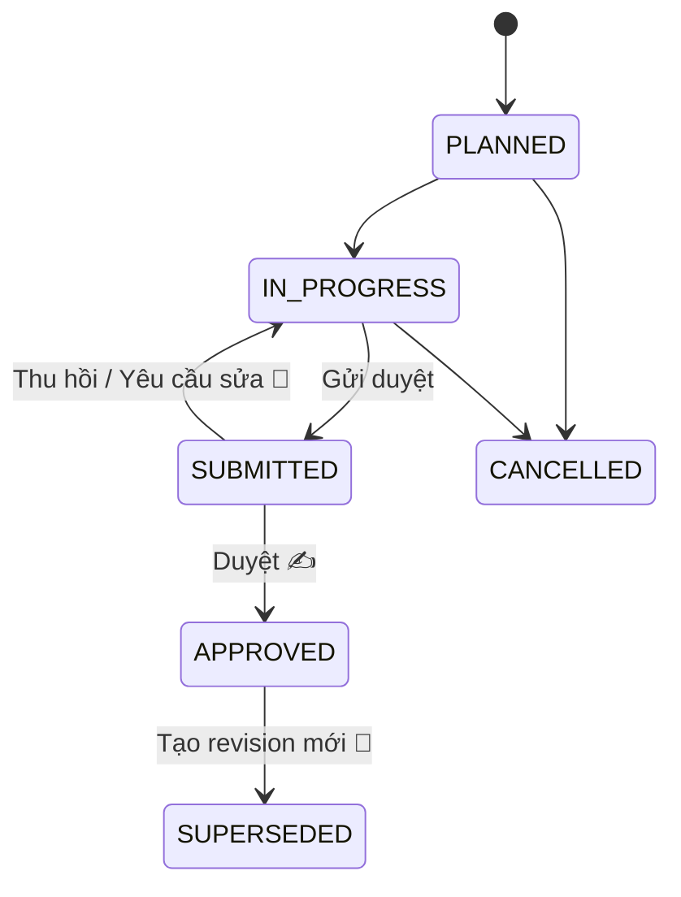
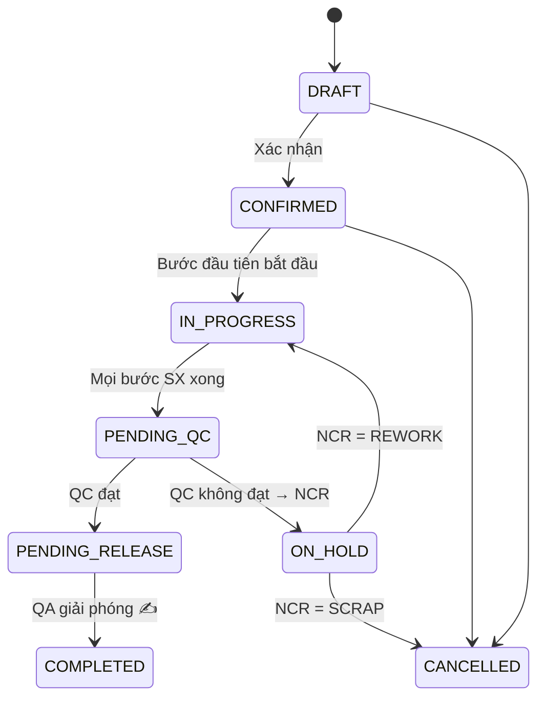
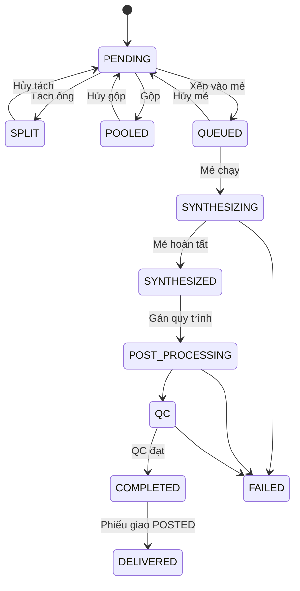
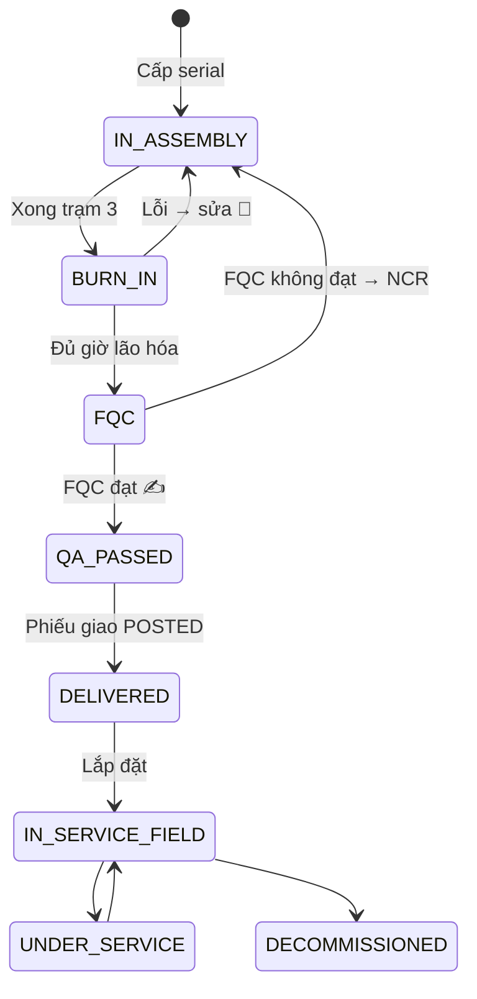

# Đặc tả máy trạng thái — Nền tảng R&D / Sản xuất Kit / Oligo / Thiết bị

> Tài liệu đính kèm cho **Bước 1** của prompt. Bảng và tên cột tham chiếu
> [01-mo-hinh-du-lieu.md](01-mo-hinh-du-lieu.md).

## 0. Quy tắc cài đặt chung

1. Mỗi máy trạng thái khai báo **một lần** trong code backend (bảng chuyển trạng thái dạng dữ liệu),
   gồm: `from`, `action`, `to`, `permission`, `guards[]`, `effects[]`, `signature_meaning?`,
   `reason_required?`.
2. Mọi thay đổi `status` đi qua một hàm duy nhất `transition(entity, action, actor, payload)`:
   - kiểm tra quyền → kiểm tra guard → (nếu cần) xác thực chữ ký PIN/mật khẩu;
   - cập nhật trong **một transaction**, khóa dòng thực thể, so `version` (khóa lạc quan);
   - ghi `core.audit_log` (+ `core.e_signature` nếu có), ghi `core.outbox_event`;
   - trả lỗi tiếng Việt nêu rõ guard nào không đạt và cần làm gì.
3. Không có API nào cho phép PATCH trực tiếp cột `status`.
4. Frontend lấy danh sách hành động hợp lệ từ API (`GET …/{id}/actions`) để hiện nút,
   không tự suy diễn.
5. Trạng thái kết thúc (`CLOSED`, `CANCELLED`, `COMPLETED`…) là bất biến; sửa sai bằng chứng từ
   đảo hoặc bản ghi mới liên kết bản cũ.
6. Mỗi máy trạng thái có unit test cho: mọi chuyển hợp lệ, ít nhất một chuyển bị cấm, mọi guard.

Ký hiệu cột **Ai**: vai trò tối thiểu (quyền cụ thể cấu hình trong RBAC).
`✍` = cần chữ ký điện tử; `✍ REVIEWED` = chữ ký với nghĩa REVIEWED (`e_signature.meaning`). `📝` = bắt buộc nhập lý do.

---

## 1. Kho & lô (`inv`)

### 1.1 Trạng thái chất lượng lô — `lot.quality_status`

| Từ | Hành động | Đến | Ai | Điều kiện (guard) | Tác động |
|---|---|---|---|---|---|
| — | create | QUARANTINE | Hệ thống | Từ phiếu nhận / lệnh SX / pha chế | Đặt vào vị trí biệt trữ |
| QUARANTINE | skip_qc | RELEASED | Hệ thống | `item.receipt_qc_required = false` | |
| QUARANTINE | sample | PENDING_QC | QC | | Tạo `qc_test` theo spec hiệu lực |
| PENDING_QC | release ✍ | RELEASED | QA_RELEASER | `qc_test.overall_result = PASS`; người giải phóng ≠ người phân tích | Chuyển vị trí khỏi biệt trữ; thông báo phòng yêu cầu |
| PENDING_QC | reject 📝 | REJECTED | QA | | Tạo NCR |
| RELEASED | hold 📝 | ON_HOLD | QA | | Giải phóng mọi `reservation` ACTIVE của lô, báo người giữ chỗ |
| ON_HOLD | unhold ✍ | RELEASED | QA_RELEASER | Không còn NCR mở trên lô | |
| ON_HOLD | reject 📝 | REJECTED | QA | | Tạo NCR |
| RELEASED | expire | EXPIRED | Job 00:05 | `expiry_date < hôm nay` | Thông báo kho; chặn cấp phát |

Chỉ `RELEASED` (và còn hạn hiệu lực) mới được phân bổ / giữ chỗ / xuất cho sản xuất.

### 1.2 Chai/ống hóa chất — `container.status`

| Từ | Hành động | Đến | Ai | Guard / Tác động |
|---|---|---|---|---|
| — | create | INCUBATING hoặc PENDING_QC hoặc AVAILABLE | Hệ thống | Hóa chất pha có `incubation_hours` → INCUBATING; `qc_required` → PENDING_QC; còn lại AVAILABLE |
| INCUBATING | finish_incubation | PENDING_QC / AVAILABLE | Người pha | Đủ thời gian ủ |
| PENDING_QC | approve ✍ | AVAILABLE | QC | |
| PENDING_QC | reject 📝 | REJECTED | QC | Ghi tiêu hủy |
| AVAILABLE | open | IN_USE | Người dùng | Ghi `opened_at`, tính `open_expiry_date` |
| IN_USE | mark_empty | EMPTY | Người dùng | Ghi ledger phần còn dư (nếu có) về 0 |
| AVAILABLE/IN_USE | discard 📝 | DISCARDED | Trưởng nhóm | Sinh phiếu ADJUSTMENT |

### 1.3 Chứng từ kho — `stock_document.status`

| Từ | Hành động | Đến | Ai | Guard | Tác động |
|---|---|---|---|---|---|
| — | create | DRAFT | Thủ kho / hệ thống | | |
| DRAFT | post | POSTED | Thủ kho / hệ thống | Mọi dòng có lot nếu item tracking LOT; tồn sau ghi ≥ 0; lô RELEASED (với ISSUE cho SX) | Ghi `stock_ledger` + `stock_balance` trong cùng transaction; tiêu thụ `reservation` |
| DRAFT | cancel | CANCELLED | Người tạo | | |
| POSTED | reverse 📝 | REVERSED | Trưởng kho | Lô chưa bị dùng tiếp (hoặc có chứng từ đảo tương ứng) | Tạo chứng từ đảo POSTED, liên kết 2 chiều |

### 1.4 Giữ chỗ — `reservation.status`
`ACTIVE → CONSUMED` (khi xuất thực tế) · `ACTIVE → RELEASED` (hủy lệnh / lô bị giữ / đổi lô).
Tổng `qty_reserved` luôn được đồng bộ trong `stock_balance`.

---

## 2. Mua hàng (`purchase`)

| Thực thể | Luồng | Guard chính |
|---|---|---|
| `purchase_request` | `DRAFT → SUBMITTED → APPROVED / REJECTED📝 → ORDERED → CLOSED` | Duyệt bởi Trưởng phòng yêu cầu; > ngưỡng tiền cần BGĐ ✍ |
| `purchase_order` | `DRAFT → ISSUED → PARTIALLY_RECEIVED → RECEIVED → CLOSED`; `DRAFT/ISSUED → CANCELLED📝` | Không hủy khi đã có phiếu nhận; `qty_received ≤ qty_ordered × (1 + dung sai)` |
| `goods_receipt` | `DRAFT → POSTED` (tạo lot QUARANTINE + RECEIPT) `→ INSPECTED` (IQC xong) | Phải có lot NSX + hạn dùng cho item tracking LOT |

---

## 3. Kinh doanh (`sales`)

### 3.1 Báo giá — `quotation.status`
`DRAFT → SENT → ACCEPTED → CONVERTED` · `SENT → REJECTED / EXPIRED (job)` · `DRAFT → CANCELLED`.
- `SENT` khóa giá (snapshot). Sửa giá → tạo phiên bản báo giá mới.
- `CONVERTED`: tạo `sales_order` mang snapshot giá; một báo giá chỉ chuyển một lần (idempotency).

### 3.2 Đơn bán — `sales_order.status`

| Hành động | Guard | Tác động |
|---|---|---|
| confirm | Có ≥1 dòng, qty > 0, khách hàng hợp lệ, mỗi dòng có `fulfilment` | Phát event `SalesOrderConfirmed` → tạo yêu cầu cho phòng KIT/OLIGO/DEVICE |
| cancel 📝 | Không dòng nào có `qty_committed > 0` hoặc giao hàng | Số SO giữ nguyên, không tái sử dụng |
| edit line | Đơn chưa CLOSED/CANCELLED; không đổi mã/xóa dòng đã có lệnh SX/giao; qty mới ≥ `qty_committed` | |
| (tự động) | Trạng thái đơn suy ra từ `qty_delivered` các dòng | |

### 3.3 Phiếu giao — `delivery_note.status`
`DRAFT → PICKED → POSTED (xuất kho) → DELIVERED (có biên bản ký) ` · `DRAFT/PICKED → CANCELLED`.
Guard: chỉ lô RELEASED; trình tự Oligo phải `COMPLETED` và chưa giao (khóa nguyên tử,
xung đột → lỗi 409); thiết bị phải `QA_PASSED`. Khi POSTED với thiết bị → kích hoạt bảo hành.

### 3.4 Yêu cầu hóa đơn — `invoice_request.status`
`REQUESTED → ISSUED (có số HĐ, ngày, file) → (CANCELLED📝 nếu hủy HĐ)`. Chỉ Kế toán.

---

## 4. Chất lượng (`qms`)

### 4.1 Phiếu QC — `qc_test.status`

| Hành động | Ai | Guard | Tác động |
|---|---|---|---|
| start | QC_ANALYST | Thiết bị đo còn hạn hiệu chuẩn; người làm đã đào tạo phương pháp | |
| submit_results | QC_ANALYST | Mọi tham số `is_critical` có giá trị | Server tính `passed` từng dòng và `overall_result` |
| review ✍ REVIEWED | QC_REVIEWER | Người duyệt ≠ người phân tích | `overall_result = FAIL` → tự tạo `deviation` + `ncr`; phát event cho thực thể gốc |
| return 📝 | QC_REVIEWER | | |
| cancel 📝 | QC lead | Chưa REVIEWED | Không tính vào điều kiện hoàn thành lệnh |

Sửa kết quả sau REVIEWED: không cho sửa; tạo phiếu QC thử lại (`retest_of_id`) có lý do.

### 4.2 Sai lệch — `deviation.status`
`OPEN → UNDER_INVESTIGATION → ACTION_DEFINED → CLOSED✍`; `OPEN → CLOSED✍📝` nếu không ảnh hưởng chất lượng.
Mức HIGH/CRITICAL bắt buộc có CAPA trước khi đóng.

### 4.3 NCR — `ncr.status`

| Từ | Hành động | Đến | Ai | Guard / Tác động |
|---|---|---|---|---|
| OPEN | propose_disposition | DISPOSITION_PROPOSED | Trưởng bộ phận | Chọn SCRAP / REWORK / RESYNTHESIZE / USE_AS_IS / RETURN_TO_SUPPLIER |
| DISPOSITION_PROPOSED | approve ✍ | APPROVED | QA (USE_AS_IS: QA + BGĐ ✍) | Phát lệnh xử lý: SCRAP → phiếu hủy; REWORK → `rework_order`; RESYNTHESIZE → trình tự mới liên kết; RETURN → phiếu trả NCC |
| DISPOSITION_PROPOSED | reject 📝 | OPEN | QA | |
| APPROVED | verify_done | CLOSED ✍ | QA | Lệnh xử lý đã hoàn thành |

### 4.4 CAPA — `capa.status`
`OPEN → ROOT_CAUSE_DONE → ACTIONS_IN_PROGRESS → EFFECTIVENESS_CHECK → CLOSED✍` ·
`EFFECTIVENESS_CHECK → ACTIONS_IN_PROGRESS` (không hiệu quả). Đóng khi mọi `capa_action` xong và
đã qua `effectiveness_check_date`.

### 4.5 Yêu cầu thay đổi / ECO — `change_request.status`

Guard `IMPACT_ASSESSMENT → PENDING_APPROVAL`: điền đủ đánh giá ảnh hưởng (tài liệu, đào tạo, tồn kho
đang có, lệnh đang chạy, đăng ký sản phẩm). `IMPLEMENTED` xảy ra khi đến hiệu lực
(ngày / từ lô / từ serial): phiên bản mới → EFFECTIVE, phiên bản cũ → OBSOLETE trong cùng transaction.

### 4.6 Tài liệu — `document_version.status`
`DRAFT → IN_REVIEW → APPROVED✍ → EFFECTIVE → OBSOLETE`; `IN_REVIEW → DRAFT📝`.
- `EFFECTIVE` khi tới `effective_date` **và** người dùng bắt buộc đã có `training_record`
  (hoặc cho phép hiệu lực kèm danh sách chưa đào tạo bị chặn ký các bước liên quan).
- Đúng một phiên bản EFFECTIVE mỗi tài liệu (`UNIQUE … WHERE status='EFFECTIVE'`).

---

## 5. Thiết bị phòng lab (`asset`)

| Thực thể | Luồng | Guard chính |
|---|---|---|
| `asset.status` | `IN_SERVICE ⇄ UNDER_MAINTENANCE`, `IN_SERVICE → OUT_OF_CALIBRATION (job) → IN_SERVICE (hiệu chuẩn PASS)`, `* → RETIRED📝` | Chỉ IN_SERVICE mới được chọn vào mẻ/bước/thí nghiệm/đặt lịch |
| `asset_event.status` | `PLANNED → DONE / CANCELLED` | DONE + PASS cập nhật hạn kế tiếp; FAIL → asset UNDER_MAINTENANCE + deviation |
| `asset_booking.status` | `REQUESTED → CONFIRMED → IN_USE → COMPLETED` · `→ CANCELLED` | Không trùng khoảng (ràng buộc DB); thiết bị phải IN_SERVICE |

---

## 6. Kế hoạch công việc (`work`) — dùng chung mọi phòng

### 6.1 Kế hoạch tuần — `work_plan.status`

- Gửi duyệt theo từng nhân viên (không gửi cả phòng một lần).
- Công việc trong kế hoạch APPROVED: không sửa/xóa; chỉ thêm việc mới với `is_unplanned = true`.
- Chỉ ghi kết quả công việc khi kế hoạch APPROVED.

### 6.2 Công việc — `work_task.status`

| Từ | Hành động | Đến | Ai | Guard |
|---|---|---|---|---|
| PLANNED | start | IN_PROGRESS | Nhân viên | Kế hoạch APPROVED |
| PLANNED/IN_PROGRESS | complete | DONE | Nhân viên | `result_summary` không rỗng |
| PLANNED/IN_PROGRESS | defer 📝 | DEFERRED | Nhân viên | Chọn `defer_category` OBJECTIVE/SUBJECTIVE; thông báo quản lý |
| PLANNED/DEFERRED | replace | REPLACED | Nhân viên / Quản lý | Tạo việc thay thế, liên kết `replaced_by_task_id` |
| DONE | rate | DONE (có `efficiency_rating`) | Quản lý | |

---

## 7. R&D (`rd`)

### 7.1 Ý tưởng — `idea.status`

Guard `EVALUATION → EVALUATED`: có ít nhất một `idea_evaluation` TECH và một BIZ đã nộp.
`APPROVED → CONVERTED`: tạo `project` với gate template phù hợp `target_domain`.

### 7.2 Dự án — `project.status` và `project.current_stage`
- `status`: `ACTIVE ⇄ ON_HOLD📝`, `ACTIVE → TRANSFERRED` (qua gate cuối), `ACTIVE/ON_HOLD → KILLED✍📝`.
- `current_stage` chỉ thay đổi khi một `project_gate` có quyết định GO; **không suy ra từ số gate đã qua**
  và không nhảy cóc.

### 7.3 Cổng — `project_gate.status`

| Từ | Hành động | Đến | Ai | Guard | Tác động |
|---|---|---|---|---|---|
| LOCKED | (tự động) | OPEN | Hệ thống | Gate trước có quyết định GO | |
| OPEN | submit | PENDING_REVIEW | Chủ nhiệm dự án | Mọi `gate_deliverable` bắt buộc ≥ SUBMITTED; file ≤ giới hạn | Thông báo Trưởng phòng R&D / hội đồng |
| PENDING_REVIEW | decide GO ✍ | PASSED | Trưởng phòng R&D (gate cuối: + BGĐ) | Mọi deliverable bắt buộc ACCEPTED | Mở gate kế; cập nhật `current_stage`; gate cuối → tạo `tech_transfer_package` |
| PENDING_REVIEW | decide RECYCLE 📝 | NEEDS_REVISION | Như trên | | Deliverable bị REJECTED trả về chủ nhiệm |
| NEEDS_REVISION | resubmit | PENDING_REVIEW | Chủ nhiệm | Như submit | |
| PENDING_REVIEW | decide HOLD/KILL ✍📝 | — | BGĐ | | Đổi `project.status` |

### 7.4 Thí nghiệm — `experiment.status`

- `start`: thiết bị dùng phải IN_SERVICE và có booking; người làm đã đào tạo protocol.
- Lấy nguyên liệu chỉ khi IN_PROGRESS → tạo phiếu ISSUE kho R&D (lô RELEASED, còn hạn).
- `SUBMITTED`: `experiment_entry` chỉ được thêm, không sửa. Thu hồi chỉ khi chưa có người duyệt mở.
- `APPROVED` bất biến; sửa = revision mới (`parent_experiment_id`), bản cũ → SUPERSEDED.

### 7.5 Mẫu sinh học — `sample.status`
`RECEIVED → STORED ⇄ IN_USE → (DEPLETED | DISPOSED📝 | TRANSFERRED)`. Mỗi lần rã đông tăng
`freeze_thaw_count`; vượt ngưỡng cấu hình → cảnh báo, chặn dùng cho thí nghiệm định lượng.

### 7.6 Gói chuyển giao — `tech_transfer_package.status`
`DRAFT → SUBMITTED → ACCEPTED✍ (bên nhận: Trưởng phòng SX Kit / Oligo / KT-CN) → COMPLETED` ·
`SUBMITTED → DRAFT📝`. `ACCEPTED` tạo bản nháp BOM/routing/spec/model ở module đích; `COMPLETED`
khi lô/máy pilot đầu tiên đạt QC.

---

## 8. Sản xuất (`mfg`) — Kit & Thiết bị

### 8.1 BOM / Routing — `bom.status`, `routing.status`
`DRAFT → IN_REVIEW → EFFECTIVE (qua change_request APPROVED) → OBSOLETE`.
Một phiên bản EFFECTIVE mỗi sản phẩm. Lệnh sản xuất ghi nhận phiên bản tại thời điểm tạo,
không đổi khi BOM đổi sau đó.

### 8.2 Lệnh sản xuất — `production_order.status`

| Từ | Hành động | Đến | Ai | Guard | Tác động |
|---|---|---|---|---|---|
| DRAFT | confirm | CONFIRMED | Kế hoạch SX | BOM & routing EFFECTIVE; sản phẩm `is_manufacturable`; đủ tồn khả dụng cho mọi dòng BOM không `is_bundled` | Cấp số lô (`number_sequence`), cố định `mfg_date`/`expiry_date`; tạo `reservation` theo FEFO; sinh `production_step` từ routing; thông báo phòng SX |
| CONFIRMED | issue_materials | CONFIRMED | Thủ kho | Có reservation đủ | Phiếu ISSUE POSTED, `material_consumption.issued_qty` |
| CONFIRMED | (bước đầu start) | IN_PROGRESS | Hệ thống | Vật tư đã xuất đủ | |
| IN_PROGRESS | (bước SX cuối xong) | PENDING_QC | Hệ thống | Mọi `production_step` không phải QC = DONE/SKIPPED (SKIPPED cần 📝 + quản lý) | Tạo `qc_test` RELEASE theo spec |
| PENDING_QC | (QC REVIEWED PASS) | PENDING_RELEASE | Hệ thống | Mọi `qc_test` không CANCELLED đều PASS | Nhập `good_qty` |
| PENDING_QC | (QC FAIL) | ON_HOLD | Hệ thống | | NCR tự tạo |
| PENDING_RELEASE | release ✍ RELEASED | COMPLETED | QA_RELEASER | Người ký ≠ người thực hiện bước; EBR không còn bước thiếu chữ ký; đối chiếu vật tư không vượt dung sai (vượt → cần 📝) | Phiếu RECEIPT thành phẩm theo `good_qty`; lô → RELEASED; `lot_genealogy`; COA sinh từ kết quả; cập nhật `fulfilment_link` / SO |
| DRAFT/CONFIRMED | cancel 📝 | CANCELLED | Kế hoạch SX | Chưa có bước nào bắt đầu | Giải phóng reservation; vật tư đã xuất → phiếu trả kho |

### 8.3 Bước EBR — `production_step.status`

| Từ | Hành động | Đến | Ai | Guard |
|---|---|---|---|---|
| PENDING | start | IN_PROGRESS | Người được giao | Bước trước DONE/SKIPPED; người làm có training `required_training_document`; thiết bị cần dùng IN_SERVICE |
| IN_PROGRESS | complete ✍ PERFORMED | DONE (hoặc AWAITING_CHECK) | Người thực hiện | `param_values` hợp lệ theo `param_schema`; giá trị ngoài giới hạn → bắt buộc tạo deviation |
| AWAITING_CHECK | check ✍ CHECKED | DONE | Người kiểm tra ≠ người thực hiện | Khi `requires_check_signature` |
| IN_PROGRESS | fail 📝 | FAILED | Người thực hiện | Tạo deviation; lệnh → ON_HOLD |
| PENDING | skip 📝 ✍ | SKIPPED | Quản lý SX | Bước được đánh dấu cho phép bỏ qua |

Bước `is_qc = true`: chỉ người thuộc QC ghi kết quả, kết quả lấy từ `qc_test` REVIEWED PASS;
bước QC cuối bắt buộc có file COA/checksheet đính kèm.

### 8.4 Làm lại — `rework_order.status`
`DRAFT → APPROVED✍ (từ NCR) → IN_PROGRESS → PENDING_QC → COMPLETED / FAILED`.
Phạm vi PARTIAL (ví dụ một hộp của kit) chỉ tạo bước và vật tư cho phần đó; kết quả gộp lại vào
lô gốc qua `lot_genealogy`.

---

## 9. Oligo (`oligo`)

### 9.1 Trình tự — `oligo_sequence.status`

| Từ | Hành động | Đến | Ai | Guard | Tác động |
|---|---|---|---|---|---|
| PENDING | edit | PENDING | Kinh doanh / Oligo | Chỉ khi PENDING | Chuẩn hóa lại, tính lại MW/Tm/ε/giá |
| PENDING | split | SPLIT | Oligo | Là chuỗi cha, chưa vào mẻ | Tạo chuỗi con `relation = SPLIT` |
| SPLIT | unsplit | PENDING | Oligo | Không chuỗi con nào khác PENDING | Xóa mềm chuỗi con |
| PENDING (≥2) | pool | POOLED | Oligo | ≥2 chuỗi; `normalized_sequence` trùng khớp; cùng purification/format/product_type; tổng tỉ lệ = 100% | Tạo `oligo_pool` + chuỗi master PENDING |
| POOLED | unpool | PENDING | Oligo | Master chưa vào mẻ | |
| PENDING | (vào mẻ) | QUEUED | Hệ thống | Khóa nguyên tử: `UPDATE … WHERE status='PENDING'` đúng số dòng, nếu không → lỗi "đã được xếp mẻ khác" | |
| SYNTHESIZED | assign_workflow | POST_PROCESSING | Oligo | Workflow EFFECTIVE phù hợp purification | Tạo `post_synth_process` |
| POST_PROCESSING | (bước cuối xong) | QC | Hệ thống | | Tạo `qc_test` OLIGO_SEQUENCE |
| QC | (QC PASS) | COMPLETED | Hệ thống | | Cập nhật COA (OD, nmol, MW đo), cho phép in nhãn |
| SYNTHESIZING/POST_PROCESSING/QC | fail 📝 | FAILED | Oligo / QC | Ghi bước xảy ra lỗi | Tạo deviation + NCR |
| FAILED | (NCR = RESYNTHESIZE) | — | Hệ thống | NCR APPROVED | Tạo chuỗi mới PENDING, `relation = RESYNTH`, cùng đơn |
| COMPLETED | (phiếu giao POSTED) | DELIVERED | Hệ thống | Chưa giao (khóa nguyên tử) | |

Amplicon nhiều mảnh: các mảnh cùng nhóm được đồng bộ tiến độ sau bước lắp ráp/PCR; mảnh thành phẩm
là một trình tự `product_type = AMPLICON_*`.

### 9.2 Đơn Oligo — `oligo_order.status` (suy ra, không chuyển tay)
- `CANCELLED` nếu bị hủy (guard: không trình tự nào đã QUEUED trở đi).
- `COMPLETED` khi mọi trình tự đang hiệu lực (bỏ qua SPLIT/POOLED cha và FAILED đã có bản tổng hợp lại)
  là COMPLETED/DELIVERED; `DELIVERED` khi tất cả DELIVERED.
- `FAILED` khi mọi trình tự FAILED không có bản tổng hợp lại.
- `IN_PROGRESS` khi có trình tự từ QUEUED trở đi; còn lại `PENDING`.
- Đổi `due_date` cần 📝, tăng `due_date_change_count`, giữ `initial_due_date`.

### 9.3 Mẻ tổng hợp — `synthesis_batch.status`

| Từ | Hành động | Đến | Ai | Guard | Tác động |
|---|---|---|---|---|---|
| — | create | PLANNED | OLIGO_OPERATOR | ≥1 trình tự PENDING; số vị trí ≤ `column_positions`; scale được máy hỗ trợ; mỗi trình tự có lô cột CPG; mọi hóa chất/amidite bắt buộc (theo modification) có lô; lô RELEASED, container AVAILABLE/IN_USE, còn hạn hiệu lực; đủ tồn theo lượng dự kiến; máy IN_SERVICE | Trình tự → QUEUED; `reservation` theo lượng dự kiến |
| PLANNED | start | RUNNING | OLIGO_OPERATOR | | Phiếu ISSUE theo lượng dự kiến; trình tự → SYNTHESIZING; ghi `asset_usage_log` |
| RUNNING | finish | COMPLETED | OLIGO_OPERATOR | Nhập `actual_qty` cho mọi `synthesis_reagent_use`, `coupling_efficiency_pct` cho mọi vị trí | Phiếu ADJUSTMENT phần chênh lệch thực tế − dự kiến; trình tự → SYNTHESIZED (vị trí lỗi → FAILED + NCR) |
| PLANNED | cancel 📝 | CANCELLED | OLIGO_OPERATOR | | Giải phóng reservation; trình tự → PENDING |
| RUNNING | abort 📝 | ABORTED | Trưởng nhóm | | Phiếu ISSUE giữ nguyên (đã tiêu hao); trình tự → FAILED + NCR |

### 9.4 Quy trình hậu tổng hợp — `post_synth_process.status`
`NOT_STARTED → IN_PROGRESS → DONE` · `IN_PROGRESS → FAILED📝`.
Mỗi `log_step`: đúng bước kế tiếp (`current_step_seq`); thiết bị IN_SERVICE; hóa chất dùng ghi
phiếu ISSUE (không cho tồn âm — thiếu thì báo kho); ghi theo nhóm được nếu `allows_batch_log`.
Sửa log bước đã ghi: 📝 + audit, không đổi người thực hiện gốc.

### 9.5 Lệnh pha chế — `preparation_order.status`
`PLANNED → IN_PROGRESS → COMPLETED` · `PLANNED/IN_PROGRESS → CANCELLED📝`.
`COMPLETED`: trong một transaction trừ lô nguyên liệu (ISSUE), tạo lô + container đầu ra (RECEIPT)
với trạng thái theo 1.2. Lúc PLANNED chỉ giữ chỗ, chưa trừ kho.

### 9.6 Bảng giá / Workflow / Modification
Theo mẫu phiên bản `DRAFT → EFFECTIVE → OBSOLETE`; chỉ Trưởng/Phó phòng Oligo hoặc BGĐ được kích hoạt
bảng giá. Báo giá/đơn đã lập giữ snapshot, không tính lại tự động (tính lại thủ công 📝).

---

## 10. Kỹ thuật-Công nghệ (`device`)

### 10.1 Đơn thiết bị — `device_order.status`
`RECEIVED → APPROVED✍ → IN_PRODUCTION → QC_TESTING → READY → DELIVERED` · `RECEIVED/APPROVED → CANCELLED📝`.
- `APPROVED`: model có revision RELEASED, BOM & routing EFFECTIVE → tạo `production_order` (domain DEVICE).
- Các trạng thái sau suy ra từ lệnh sản xuất và `device_unit`.

### 10.2 Lệnh lắp ráp
Dùng máy trạng thái 8.2 / 8.3 với routing 4 trạm (cơ khí → điện & bo mạch → module & firmware →
lão hóa & FQC). Cấp phát linh kiện theo BOM, lô theo FIFO (FEFO nếu có hạn), không xuất vượt tồn.

### 10.3 Máy (serial) — `device_unit.status`

| Hành động | Guard | Tác động |
|---|---|---|
| assign_serial | Lệnh lắp ráp CONFIRMED | Serial từ `number_sequence`, không tái sử dụng |
| install_component (trạm 1–3) | Linh kiện có lô/serial đã xuất cho lệnh | Ghi `device_unit_component` (DHR) |
| to_fqc | `burn_in_run.hours ≥ required_hours` và PASS | Tạo `qc_test` FQC theo spec model |
| qa_pass ✍ | FQC REVIEWED PASS; DHR đủ mọi dòng BOM `is_critical` | |
| deliver | Phiếu giao POSTED | `warranty_start` = ngày giao, `warranty_end` = + `warranty_months`; tạo `service_schedule` |

### 10.4 Gia công ngoài — `subcontract_order.status`
`DRAFT → ISSUED → PARTIALLY_RECEIVED → RECEIVED → CLOSED` · `DRAFT/ISSUED → CANCELLED📝`.
Mỗi lần nhận: lô QUARANTINE + IQC (đo dung sai theo bản vẽ). IQC: PASS → nhập kho phần
`qty_accepted`; REWORK → trả NCC làm lại (dòng chờ nhận lại); REJECT → NCR. Không nhập kho khi
`qty_accepted = 0`. Đóng đơn → mở `vendor_evaluation` loại POST_ORDER.

### 10.5 Phiếu dịch vụ — `service_ticket.status`
`OPEN → DIAGNOSING → AWAITING_PARTS → IN_REPAIR → RESOLVED → CLOSED✍(khách xác nhận)` ·
`OPEN → CANCELLED📝`. `is_warranty` tự xác định từ `warranty_end`; COMPLAINT bắt buộc đánh giá
cần CAPA hay không trước khi đóng. Linh kiện thay thế ghi vào DHR của máy.

### 10.6 Model & revision — `model_revision.status`
`DRAFT → RELEASED (change_request DESIGN_ECO IMPLEMENTED, hoặc gate chuyển giao PASSED) → OBSOLETE`.
Revision mới chỉ áp dụng cho serial theo `effectivity` của ECO; máy đã sản xuất giữ revision cũ.

---

## 11. Bảng kiểm tra chéo cho AI khi thiết kế
- [ ] Mỗi trạng thái trong tài liệu này có trong `CHECK` constraint của cột `status` tương ứng.
- [ ] Mỗi hành động ✍ ghi `core.e_signature` với `record_hash`; mỗi 📝 lưu `reason` vào audit.
- [ ] Tách nhiệm vụ: người thực hiện ≠ người kiểm tra/duyệt/giải phóng — kiểm tra ở backend.
- [ ] Mọi guard liên quan tồn kho đọc `stock_balance` có khóa dòng trong cùng transaction.
- [ ] Mọi trạng thái "suy ra" (đơn Oligo, SO, đơn thiết bị) được tính lại trong cùng transaction
      với thay đổi của thực thể con, không tính ở frontend.
- [ ] Job định kỳ: hết hạn lô/container, quá hạn hiệu chuẩn, hết hạn báo giá, nhắc bảo trì máy
      khách hàng, nhắc tài liệu đến hạn xem xét, đối chiếu `stock_balance` với `stock_ledger`.
